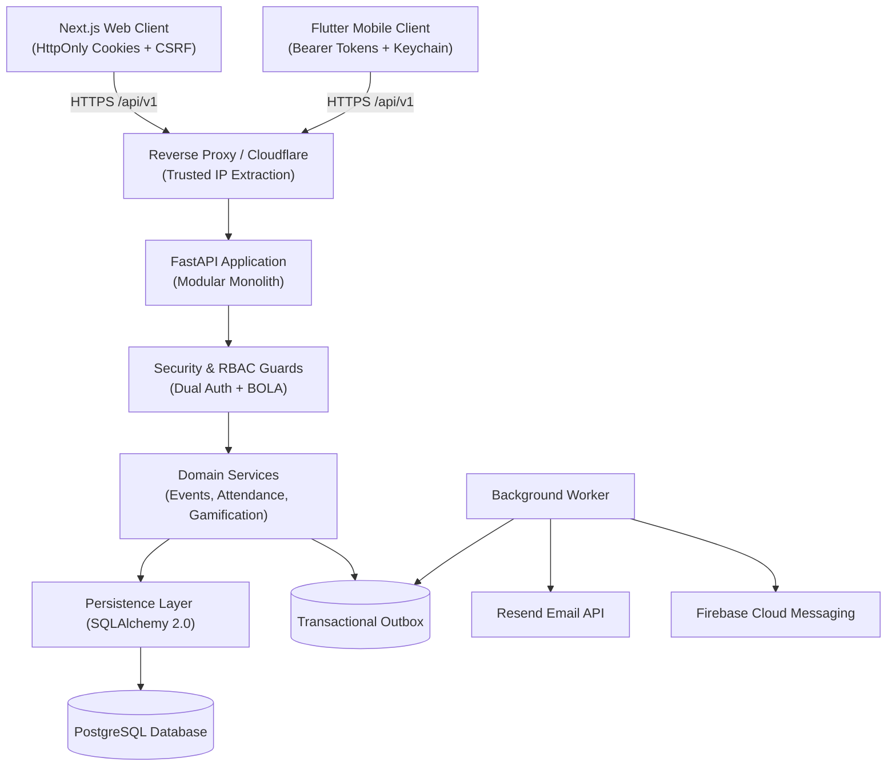
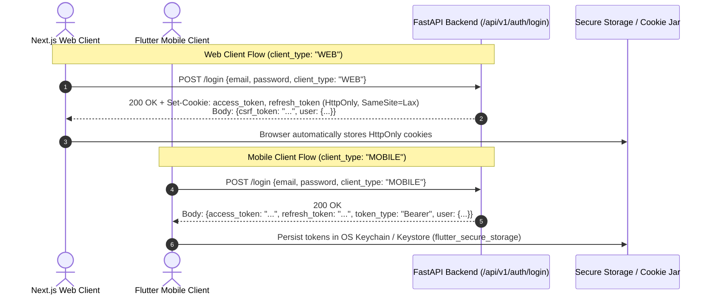
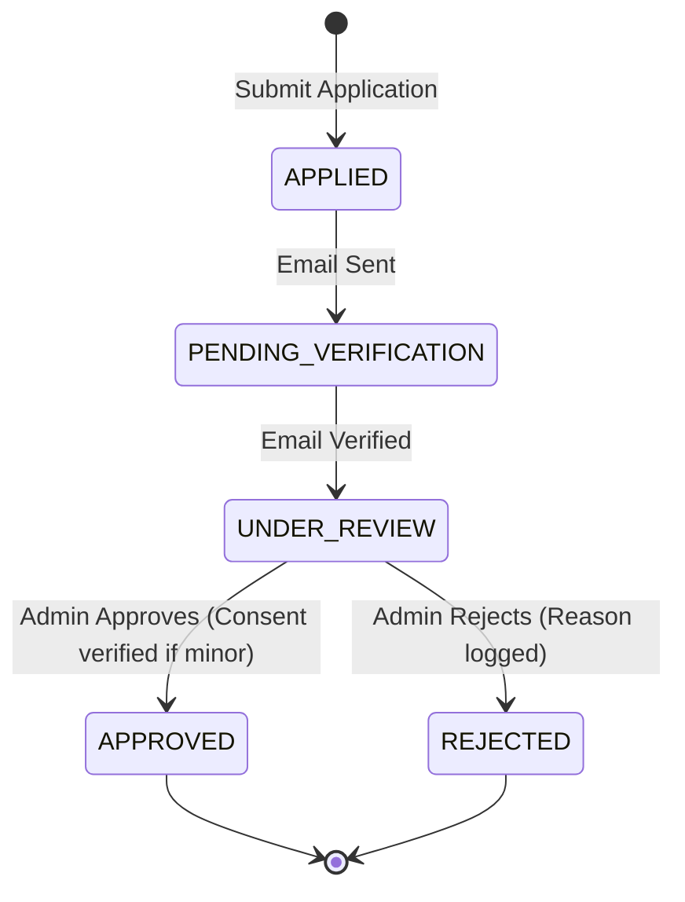
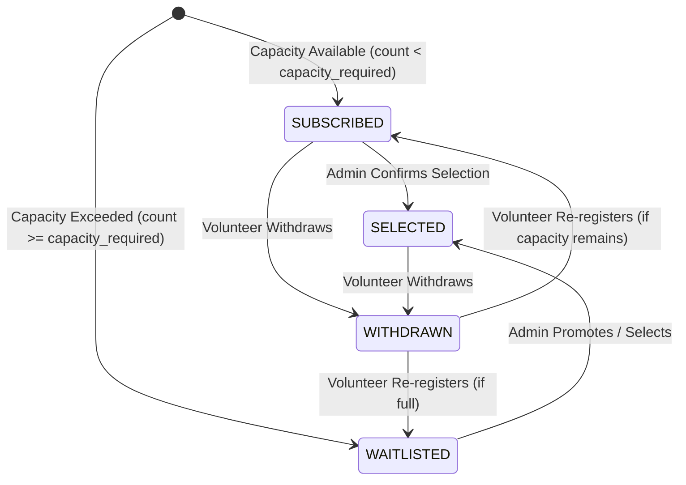

# Frontend & Client Integration Handbook
**Maatram Volunteering & Gamification Portal**
*Architecture, Protocols, Canonical Contracts, and Client Implementation Guidelines*

---

## 1. System Overview & Unified Architecture

The Maatram Volunteering & Gamification Portal operates as a **unified modular monolith** powered by FastAPI, SQLAlchemy 2.0 (async), and PostgreSQL. 

A single backend repository provides the authoritative business logic, validation rules, authentication enforcement, and gamification calculations for all client applications:
- **Next.js Web Application** (`/web`): Desktop and mobile web portal for volunteers, coordinators, and administrators.
- **Flutter Mobile Application** (`/mobile`): Native Android and iOS application for on-the-go volunteering, live event attendance, push notifications, and gamification tracking.

### Core Architectural Principles
1. **Database as Single Source of Truth**: All metrics, leaderboards, attendance durations, and volunteer tiers are computed directly from canonical PostgreSQL records. Clients never fabricate or calculate gamification or attendance figures locally.
2. **Unified Backend Invariants**: Both Web and Mobile clients consume the identical `/api/v1` REST API. No business logic or scoring logic is bifurcated across clients.
3. **Transactional Outbox for Asynchronous Jobs**: Communications (emails via Resend, push notifications via Firebase FCM) are persisted in transactional outbox tables and processed asynchronously by background workers, guaranteeing delivery without blocking request cycles.
4. **Zero-Trust Client Access**: Clients never connect directly to the database or storage providers without signed backend authorization.



---

## 2. Canonical API Specifications & Base URL

- **Canonical API Base Path**: `/api/v1`
- **Specification Artifact**: `server/openapi.json`
- **Schema Drift Protection**: The OpenAPI specification is deterministically generated and committed. CI runs structural drift tests (`server/tests/contract/test_openapi_drift.py`) comparing runtime Pydantic models against `openapi.json`. Any undocumented schema change fails the build.

### Endpoint Prefix Hierarchy
| Domain | Route Prefix | Description |
| :--- | :--- | :--- |
| **Authentication** | `/api/v1/auth` | Login, registration, token refresh, password resets, session lifecycle |
| **Volunteer Applications** | `/api/v1/applications` | Application submission, admin review, parental consent verification |
| **Volunteer Profiles** | `/api/v1/volunteers` | Profile management, document uploads, privacy settings |
| **Events & Opportunities** | `/api/v1/events` | Event CRUD, discovery, filtering, capacity management |
| **Event Registrations** | `/api/v1/events/{id}/register` | Volunteer self-registration, admin selection, withdrawals |
| **Attendance & Verification** | `/api/v1/attendance` | QR code scanning, batch check-in/out, coordinator corrections |
| **Gamification & Badges** | `/api/v1/gamification` | Point ledgers, badge progression, leaderboard rankings |
| **Media Management** | `/api/v1/media` | Signed Cloudinary upload signatures, media metadata persistence |
| **System Health** | `/api/v1/health` | Decoupled liveness (`/liveness`) and readiness (`/readiness`) probes |

---

## 3. Dual Authentication Strategy

The backend enforces a tailored dual authentication strategy designed for the distinct security properties of web browsers and native mobile platforms.



### Web Authentication Details
- **Credential Storage**: Access token and refresh token are stored exclusively in **HttpOnly, Secure, SameSite=Lax** cookies. JavaScript running in the browser cannot read these tokens, mitigating Cross-Site Scripting (XSS) token theft.
- **CSRF Token**: State-changing requests (`POST`, `PUT`, `PATCH`, `DELETE`) require an `X-CSRF-Token` header matching the signed CSRF cookie or session token.

### Mobile Authentication Details
- **Credential Storage**: Bearer tokens (`access_token`, `refresh_token`) are returned in the response payload. The mobile app persists them using `flutter_secure_storage` (backed by iOS Keychain and Android EncryptedSharedPreferences).
- **Request Authorization**: Attached via standard HTTP header:
  ```http
  Authorization: Bearer <access_token>
  ```
- **CSRF Exemption**: Mobile requests utilizing Bearer authentication headers are inherently immune to ambient-credential CSRF attacks and are exempt from CSRF checks.

---

## 4. Token Rotation & Lineage Tracking

Security is maintained through strict token lifespan and reuse detection:

- **Access Token**: Short-lived (15 minutes). Contains `sub` (User UUID), `role`, `session_id`, and `exp`.
- **Refresh Token**: Long-lived (7 days). Single-use only.
- **Rotation Protocol**: Every call to `POST /api/v1/auth/refresh` issues a new access token **and** a newly rotated refresh token. The previous refresh token is immediately invalidated in the database.
- **Replay / Theft Detection**: Each refresh token belongs to a cryptographically tracked lineage family. If an already-invalidated refresh token is presented:
  1. The server detects token replay (indicating potential exfiltration).
  2. The server **immediately revokes all active sessions** and token lineages associated with that user.
  3. Returns HTTP `401 Unauthorized` with code `TOKEN_REVOKED`.
  4. The user is forced to re-authenticate with their primary credentials.

---

## 5. Cross-Site Request Forgery (CSRF) Protection

Web clients must implement the double-submit CSRF pattern for mutating operations:

1. Upon login or session initialization, the server issues a CSRF token in the response body (`csrf_token`) and sets a corresponding `csrf_token` cookie.
2. For all non-safe HTTP methods (`POST`, `PUT`, `PATCH`, `DELETE`), the client must echo this value in the request header:
   ```http
   X-CSRF-Token: <csrf_token_string>
   ```
3. If the header is missing or does not match, the server rejects the request with HTTP `403 Forbidden` (`CSRF_INVALID`).

---

## 6. Error Handling & Canonical Error Envelopes

All errors emitted by the API follow a strict, predictable JSON envelope:

```json
{
  "error": {
    "code": "RATE_LIMIT_EXCEEDED",
    "message": "Too many requests. Please try again later.",
    "details": {
      "retry_after_seconds": 900
    },
    "timestamp": "2026-11-08T13:45:00.000000Z"
  }
}
```

### Standard Error Codes
| HTTP Status | Error Code | Description | Client Action |
| :--- | :--- | :--- | :--- |
| `400` | `VALIDATION_ERROR` | Request body or query parameters failed schema rules | Highlight invalid fields in UI |
| `400` | `MINOR_CONSENT_UNVERIFIED` | Volunteer is under 18 and lacks verified parental consent | Prompt coordinator to verify consent |
| `400` | `SCHEDULE_CONFLICT` | Volunteer already has an overlapping active event | Prompt user to choose between events |
| `401` | `UNAUTHORIZED` | Missing or invalid access token | Trigger token refresh flow |
| `401` | `TOKEN_EXPIRED` | Access token has expired | Call `/api/v1/auth/refresh` |
| `401` | `TOKEN_REVOKED` | Token was revoked or replayed | Clear stored tokens; redirect to login |
| `403` | `FORBIDDEN` | Insufficient RBAC permissions or BOLA violation | Display permission denied message |
| `404` | `NOT_FOUND` | Resource ID does not exist | Display 404 empty state |
| `409` | `CONFLICT` | Resource already exists or invariant violation | Refresh list and warn user |
| `429` | `RATE_LIMIT_EXCEEDED` | Request rate limit exceeded | Inspect `Retry-After` header and back off |
| `503` | `SERVICE_UNAVAILABLE` | Database readiness probe failed | Display maintenance notice |

---

## 7. Pagination & Query Parameters Standard

All collection endpoints implement standardized pagination parameters:

### Request Query Parameters
- `page`: 1-based page number (default: `1`).
- `limit`: Number of items per page (default: `20`, maximum: `100`).
- `page_size`: Supported as an alias for `limit` for backwards compatibility.

### Standard Paginated Response Envelope
```json
{
  "items": [...],
  "total": 142,
  "page": 1,
  "limit": 20,
  "total_pages": 8
}
```

Clients must bound UI pagination components by `total_pages` and disable forward navigation when `page >= total_pages`.

---

## 8. Reverse Proxy & IP Resolution

Rate limiting, audit logging, and session tracking rely on accurate client IP resolution:

- The backend implements secure right-to-left traversal of the `X-Forwarded-For` header via `extract_client_ip(request)`.
- Untrusted proxy headers are discarded unless the request originated from an explicitly configured IP in `TRUSTED_PROXY_IPS` or official Cloudflare IP ranges.
- This prevents IP spoofing attacks where malicious clients attempt to bypass rate limits by injecting artificial headers.

---

## 9. Volunteer Onboarding & Multi-Stage Application Workflow



1. **Submission**: Volunteer registers via `POST /api/v1/auth/register` with demographic profile data.
   - If `category == "STUDENT"`, the `student_details` object is mandatory (`college_name`, `degree`, `department`, `batch_year`, `current_year`, `maatram_reg_number`).
2. **Email Verification**: An outbox job dispatches a verification token to the volunteer's email. Volunteer activates account via `POST /api/v1/auth/verify-email`.
3. **Application Review**: Administrators inspect pending applications at `GET /api/v1/applications`.
4. **Approval / Rejection**: Admin calls `POST /api/v1/applications/{id}/approve` or `POST /api/v1/applications/{id}/reject`.

---

## 10. Minor Safeguarding Protocol (<18)

Maatram enforces strict child safeguarding for volunteers under 18 years of age:

1. **Age Assessment**: When a volunteer profile indicates `age < 18` or `date_of_birth` calculates to $<18$ years:
   - The application is flagged as requiring parental consent.
   - The profile must include: `parent_name`, `parent_email`, `parent_phone`, and an uploaded `consent_form_media_id`.
2. **Approval Gate**: Calling `POST /api/v1/applications/{id}/approve` on an unverified minor triggers:
   ```json
   {
     "error": {
       "code": "MINOR_CONSENT_UNVERIFIED",
       "message": "Cannot approve applicant under 18 without verified parental consent."
     }
   }
   ```
3. **Consent Verification**: An administrator or coordinator must inspect the signed consent form and call:
   ```http
   PATCH /api/v1/applications/{id}/verify-parental-consent
   ```
   Only after this call succeeds can the application be approved.

---

## 11. Event Discovery & Registration Lifecycle

### Event States
- `DRAFT` $\to$ `PUBLISHED` $\to$ `REGISTRATION_CLOSED` $\to$ `ONGOING` $\to$ `COMPLETED` (or `CANCELLED`).

### Registration States


- **Pessimistic Concurrency**: The backend locks the event row (`SELECT ... FOR UPDATE`) during registration. Concurrent bursts of registrations are serialized, ensuring capacity limits are strictly respected without overbooking.

---

## 12. Attendance Tracking & Duration Calculation

Attendance is verified on-site during active events:

1. **Batch Check-In**: Coordinators scan volunteer QR codes or execute batch check-in:
   ```http
   POST /api/v1/attendance/check-in
   {
     "event_id": "<uuid>",
     "registration_ids": ["<uuid1>", "<uuid2>"],
     "check_in_time": "2026-11-08T09:00:00Z"
   }
   ```
2. **Batch Check-Out**: Upon event conclusion:
   ```http
   POST /api/v1/attendance/check-out
   {
     "event_id": "<uuid>",
     "registration_ids": ["<uuid1>", "<uuid2>"],
     "check_out_time": "2026-11-08T12:00:00Z"
   }
   ```
3. **Duration Calculation Invariant**:
   $$\text{duration\_hours} = \text{round}\left(\frac{\text{check\_out\_time} - \text{check\_in\_time}}{3600}, 2\right)$$
   For a 180-minute shift, duration is exactly `3.00` hours.
4. **Performance Guarantee**: Batch attendance operations execute in $<15$ database queries for 100 volunteers by utilizing bulk lookups and avoiding N+1 relationship loads.

---

## 13. Gamification & Authoritative Scoring Formula

Points, badges, and tiers are calculated deterministically by the backend.

### Scoring Formula
Upon event completion (`POST /api/v1/events/{id}/complete-and-award`):
$$P = (E \times 10) + (H \times 2)$$

Where:
- $P$ = Total points awarded for the event.
- $E$ = Event completion bonus ($1 \times 10 = 10\text{ points}$).
- $H$ = Verified volunteering duration in hours ($H \times 2\text{ points/hour}$).

*Example*: A completed 3-hour event awards:
$$P = (1 \times 10) + (3.00 \times 2) = 10 + 6.00 = 16.00\text{ points}$$

### Tier Progression
| Tier | Minimum Points | Badge Icon |
| :--- | :--- | :--- |
| **BRONZE** | 0 | Bronze Seed |
| **SILVER** | 50 | Silver Sprout |
| **GOLD** | 200 | Gold Tree |
| **PLATINUM** | 500 | Platinum Maatram Crown |

### Affirmative Privacy Consent
The public leaderboard (`GET /api/v1/gamification/leaderboard`) strictly honors volunteer privacy:
- Volunteers must explicitly enable `leaderboard_visible: true` in their profile consent settings.
- Volunteers who opt out are excluded from public rankings to comply with data privacy policies.

---

## 14. Outbox Asynchronous Communications

All notifications and transactional emails use the Transactional Outbox pattern:
1. When a business event occurs (e.g., application approved, event reminder), the service inserts a job into the `communication_outbox` table within the **same database transaction**.
2. If the transaction rolls back, no email is sent.
3. A background worker periodically polls for `PENDING` outbox jobs, sends them via Resend or Firebase FCM with exponential backoff retry, and marks them `COMPLETED` or `FAILED`.

---

## 15. Media Assets & Cloudinary Upload Protocol

Media files (avatars, event covers, consent forms) are uploaded directly from the client to Cloudinary without streaming through the backend:

1. **Request Signature**:
   ```http
   POST /api/v1/media/upload-signature
   {
     "folder": "volunteer_avatars",
     "resource_type": "image"
   }
   ```
2. **Direct Upload**: Client uploads directly to Cloudinary using the returned signature, timestamp, and API key.
3. **Register Media**: Client informs backend of the upload:
   ```http
   POST /api/v1/media
   {
     "public_id": "maatram/avatars/abc123",
     "url": "https://res.cloudinary.com/.../abc123.jpg",
     "format": "jpg",
     "bytes": 245000,
     "media_type": "IMAGE"
   }
   ```

---

## 16. Complete Web Fetch Client Snippet

Below is the production-ready TypeScript client implementation for Next.js web applications, incorporating credentials cookies, CSRF header attachment, automatic 401 token refresh, and typed error handling.

```typescript
// web/src/lib/api-client.ts

export interface ApiErrorPayload {
  error: {
    code: string;
    message: string;
    details?: Record<string, unknown>;
    timestamp: string;
  };
}

export class ApiError extends Error {
  public code: string;
  public status: number;
  public details?: Record<string, unknown>;

  constructor(status: number, payload: ApiErrorPayload) {
    super(payload.error.message);
    this.name = "ApiError";
    this.status = status;
    this.code = payload.error.code;
    this.details = payload.error.details;
  }
}

let csrfTokenCache: string | null = null;

export function setCsrfToken(token: string | null) {
  csrfTokenCache = token;
}

export async function apiClient<T>(
  endpoint: string,
  options: RequestInit = {}
): Promise<T> {
  const baseUrl = process.env.NEXT_PUBLIC_API_URL || "http://localhost:8000/api/v1";
  const url = `${baseUrl}${endpoint.startsWith("/") ? endpoint : `/${endpoint}`}`;

  const headers: Record<string, string> = {
    "Content-Type": "application/json",
    Accept: "application/json",
    ...(options.headers as Record<string, string>),
  };

  // Attach CSRF token for mutating requests in WEB context
  const method = (options.method || "GET").toUpperCase();
  if (["POST", "PUT", "PATCH", "DELETE"].includes(method) && csrfTokenCache) {
    headers["X-CSRF-Token"] = csrfTokenCache;
  }

  const config: RequestInit = {
    ...options,
    headers,
    credentials: "include", // Send HttpOnly cookies
  };

  let response = await fetch(url, config);

  // Handle Token Expiration and Refresh (401)
  if (response.status === 401 && !endpoint.includes("/auth/refresh") && !endpoint.includes("/auth/login")) {
    try {
      const refreshRes = await fetch(`${baseUrl}/auth/refresh`, {
        method: "POST",
        headers: { "Content-Type": "application/json" },
        credentials: "include",
      });

      if (refreshRes.ok) {
        const refreshData = await refreshRes.json();
        if (refreshData.csrf_token) {
          setCsrfToken(refreshData.csrf_token);
          headers["X-CSRF-Token"] = refreshData.csrf_token;
        }
        // Retry the original request
        response = await fetch(url, { ...options, headers, credentials: "include" });
      } else {
        // Refresh failed: session revoked
        window.location.href = "/login?expired=1";
        throw new Error("Session expired. Please log in again.");
      }
    } catch (err) {
      window.location.href = "/login?expired=1";
      throw err;
    }
  }

  if (!response.ok) {
    let errorPayload: ApiErrorPayload;
    try {
      errorPayload = await response.json();
    } catch {
      errorPayload = {
        error: {
          code: "UNKNOWN_ERROR",
          message: `HTTP Error ${response.status}: ${response.statusText}`,
          timestamp: new Date().toISOString(),
        },
      };
    }
    throw new ApiError(response.status, errorPayload);
  }

  if (response.status === 204) {
    return {} as T;
  }

  return response.json();
}
```

---

## 17. Complete Flutter Dio Client Snippet

Below is the production-grade Flutter / Dart client implementation using `dio` and `flutter_secure_storage`. It includes a thread-safe `QueuedInterceptor` that buffers concurrent 401 requests during token refresh and replays them cleanly once rotation completes.

```dart
// mobile/lib/core/network/api_client.dart

import 'dart:async';
import 'package:dio/dio.dart';
import 'package:flutter_secure_storage/flutter_secure_storage.dart';

class TokenStorage {
  static const _accessKey = 'maatram_access_token';
  static const _refreshKey = 'maatram_refresh_token';
  final FlutterSecureStorage _storage;

  TokenStorage({FlutterSecureStorage? storage})
      : _storage = storage ?? const FlutterSecureStorage();

  Future<void> saveTokens({required String accessToken, required String refreshToken}) async {
    await _storage.write(key: _accessKey, value: accessToken);
    await _storage.write(key: _refreshKey, value: refreshToken);
  }

  Future<String?> getAccessToken() => _storage.read(key: _accessKey);
  Future<String?> getRefreshToken() => _storage.read(key: _refreshKey);

  Future<void> clearTokens() async {
    await _storage.delete(key: _accessKey);
    await _storage.delete(key: _refreshKey);
  }
}

class AuthInterceptor extends QueuedInterceptor {
  final Dio dio;
  final TokenStorage tokenStorage;
  final String baseUrl;
  bool _isRefreshing = false;

  AuthInterceptor({
    required this.dio,
    required this.tokenStorage,
    required this.baseUrl,
  });

  @override
  Future<void> onRequest(
    RequestOptions options,
    RequestInterceptorHandler handler,
  ) async {
    final token = await tokenStorage.getAccessToken();
    if (token != null && !options.headers.containsKey('Authorization')) {
      options.headers['Authorization'] = 'Bearer $token';
    }
    handler.next(options);
  }

  @override
  Future<void> onError(
    DioException err,
    ErrorInterceptorHandler handler,
  ) async {
    // Check if error is 401 and request was not already a refresh attempt
    if (err.response?.statusCode == 401 &&
        !err.requestOptions.path.contains('/auth/refresh') &&
        !err.requestOptions.path.contains('/auth/login')) {
      
      final refreshToken = await tokenStorage.getRefreshToken();
      if (refreshToken == null) {
        await tokenStorage.clearTokens();
        return handler.reject(err);
      }

      try {
        // Dedicated token refresh client avoiding circular interceptor calls
        final refreshDio = Dio(BaseOptions(baseUrl: baseUrl));
        final response = await refreshDio.post(
          '/auth/refresh',
          data: {'refresh_token': refreshToken},
        );

        if (response.statusCode == 200) {
          final newAccessToken = response.data['access_token'] as String;
          final newRefreshToken = response.data['refresh_token'] as String;

          await tokenStorage.saveTokens(
            accessToken: newAccessToken,
            refreshToken: newRefreshToken,
          );

          // Update header and retry the original request
          final retryOptions = err.requestOptions;
          retryOptions.headers['Authorization'] = 'Bearer $newAccessToken';

          final clonedResponse = await dio.fetch(retryOptions);
          return handler.resolve(clonedResponse);
        }
      } catch (refreshError) {
        // Refresh token failed or replayed: clear credentials to force re-login
        await tokenStorage.clearTokens();
        return handler.reject(err);
      }
    }

    handler.next(err);
  }
}

class ApiClient {
  late final Dio dio;
  final TokenStorage tokenStorage;
  final String baseUrl;

  ApiClient({
    String? baseUrl,
    TokenStorage? tokenStorage,
  })  : baseUrl = baseUrl ?? 'http://10.0.2.2:8000/api/v1',
        tokenStorage = tokenStorage ?? TokenStorage() {
    dio = Dio(
      BaseOptions(
        baseUrl: this.baseUrl,
        connectTimeout: const Duration(seconds: 10),
        receiveTimeout: const Duration(seconds: 10),
        headers: {
          'Content-Type': 'application/json',
          'Accept': 'application/json',
        },
      ),
    );

    dio.interceptors.add(
      AuthInterceptor(
        dio: dio,
        tokenStorage: this.tokenStorage,
        baseUrl: this.baseUrl,
      ),
    );
  }
}
```

---

## 18. Conclusion & Developer Checklist

Before submitting code connecting to the Maatram backend:
- [ ] Ensure all requests target the `/api/v1` namespace.
- [ ] For Web: verify `credentials: "include"` is set on all fetch requests and the `X-CSRF-Token` header is attached on mutations.
- [ ] For Mobile: verify `Authorization: Bearer <token>` is attached and tokens are stored in Keychain / EncryptedSharedPreferences.
- [ ] Verify that errors are parsed via the standard `error.code` envelope rather than raw status code string matching.
- [ ] Verify that pagination parameters pass `page` and bounded `limit` ($\le 100$).
- [ ] Confirm that all point awards and gamification ranks are fetched directly from `/api/v1/gamification` endpoints without client-side score overrides.
