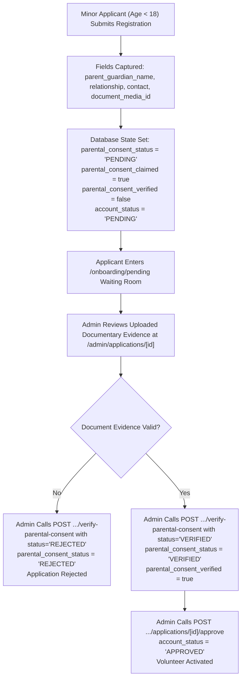

# MAATRAM VOLUNTEERING & GAMIFICATION PORTAL
## Web Application — Comprehensive Product, Design & Architecture Specification

**Document Version:** 2.1.0 (Final Pre-Implementation Canonical Specification)  
**Status:** FINAL APPROVED FOR IMPLEMENTATION SIGN-OFF  
**Date:** 2026-11-03  
**Authors:** Senior Product Designer & Frontend Systems Architect  
**Primary Visual Reference:** 9-Screen Maatram Interface Reference (`media_1793701809062_b4b2702a.jpg`)  
**Canonical Source of Truth:** FastAPI Backend (`server/`), 29 PostgreSQL tables, and verified companion specifications.

---

## Companion Specifications Index
This document serves as the master specification. For domain-level details, refer to:
1. **API Integration Matrix**: [`docs/WEB_API_INTEGRATION_MATRIX.md`](file:///C:/Users/Logesh/Documents/Maatram_Gamification/docs/WEB_API_INTEGRATION_MATRIX.md)
2. **Route & Authorization Matrix**: [`docs/WEB_ROUTE_AND_PERMISSION_MATRIX.md`](file:///C:/Users/Logesh/Documents/Maatram_Gamification/docs/WEB_ROUTE_AND_PERMISSION_MATRIX.md)
3. **Design System & Components**: [`docs/WEB_DESIGN_SYSTEM.md`](file:///C:/Users/Logesh/Documents/Maatram_Gamification/docs/WEB_DESIGN_SYSTEM.md)
4. **Motion & Interaction Specification**: [`docs/WEB_MOTION_AND_INTERACTION_SPEC.md`](file:///C:/Users/Logesh/Documents/Maatram_Gamification/docs/WEB_MOTION_AND_INTERACTION_SPEC.md)
5. **Visual Asset Strategy & Plan**: [`docs/WEB_ASSET_PLAN.md`](file:///C:/Users/Logesh/Documents/Maatram_Gamification/docs/WEB_ASSET_PLAN.md)
6. **Implementation Phasing & Milestones**: [`docs/WEB_IMPLEMENTATION_MILESTONES.md`](file:///C:/Users/Logesh/Documents/Maatram_Gamification/docs/WEB_IMPLEMENTATION_MILESTONES.md)

---

## 1. Executive Summary & Design Philosophy

The Maatram Volunteering & Gamification Portal web application provides a responsive, role-differentiated experience for students, alumni, corporate professionals, and foundation administrators. The portal connects passionate volunteers with educational enablement initiatives (School Visits, Mock Interviews, Background Verification / BGV Support) while celebrating community impact through an ethical, non-exploitative gamification framework.

### 1.1 Core Principles
1. **Human-Centered & Welcoming**: Warm, accessible, and community-first aesthetics. Avoid cold SaaS, futuristic neon AI dashboards, or sterile enterprise grids.
2. **Database as Sole Source of Truth**: All metrics, counts, leaderboard rankings, and status transitions derive exclusively from canonical PostgreSQL endpoints via the unified FastAPI backend (`/api/v1`).
3. **Zero Fabricated Metrics**: No unverified or simulated statistics (e.g. "1,200+ Volunteers", "4,800+ Verified Hours") will be hardcoded into public interfaces. Public impact is communicated via authentic mission storytelling until canonical public endpoints are implemented.
4. **Strict Minor Safeguarding**: Volunteers under 18 require independent documentary parental consent verification by administrators before account activation. A submitted parental consent claim is never treated as verified consent.
5. **Privacy-by-Design & Ethical Gamification**: 6 granular affirmative consent switches govern public recognition. Leaderboards honor opt-out preferences seamlessly.
6. **Universal Accessibility**: WCAG 2.1 AA compliant contrast ratios, accessible form controls, keyboard navigation, and responsive touch targets (minimum 44x44px).

---

## 2. Brand Identity & Visual Tokens

### 2.1 Brand Identity & Typography
- **Primary Logo**: Official Maatram Foundation emblem with Tamil calligraphy **மாற்றம்** and tagline *"Educational Aid Foundation"*. Sourced from `maatram_logo-removebg-preview.png` (709x352 px, 2.014:1 aspect ratio). Preserved without distortion.
- **Typography Scale**:
  - **Headings & Display**: Inter / Plus Jakarta Sans.
  - **Body & UI**: Inter.
  - **Monospace**: JetBrains Mono.

### 2.2 Color Tokens

| Token Name | Hex Code | Usage Context |
| :--- | :--- | :--- |
| `--color-brand-primary` | `#F5B817` | Primary CTA buttons, active state indicators, trophy highlights |
| `--color-brand-hover` | `#E5A800` | Button hover and pressed states |
| `--color-brand-subtle` | `#FFF8E7` | Active pill background, selected tab highlight, alert cards |
| `--color-brand-text` | `#946C00` | High-contrast brand text on subtle yellow backgrounds |
| `--color-bg-canvas` | `#FAF8F3` | Warm ivory global canvas background (Public & Volunteer) |
| `--color-surface-card` | `#FFFFFF` | Card surfaces, modals, dropdown menus |
| `--color-border-subtle` | `#EBE6DD` | Standard card borders, table dividers |
| `--color-border-focus` | `#F5B817` | Form control focus rings (2px offset) |
| `--color-text-primary` | `#1F2421` | Deep charcoal for primary headings and prominent data |
| `--color-text-secondary`| `#6B7280` | Subtitles, helper text, table column headers |
| `--color-text-muted` | `#9CA3AF` | Inactive icons, timestamps, disabled indicators |
| `--color-admin-sidebar` | `#16171A` | Admin command sidebar background |
| `--color-admin-card` | `#212328` | Admin dark sub-panels and elevated elements |

### 2.3 Semantic Status Tokens

| Semantic Status | Background | Text Color | Border Color | Icon / Meaning |
| :--- | :--- | :--- | :--- | :--- |
| **Approved / Selected / Attended**| `#DEF7EC` | `#03543F` | `#BCF0DA` | Green check / Active, verified status |
| **Pending / Waitlisted / In Review**| `#FEF08A` | `#854D0E` | `#FDE047` | Amber clock / Awaiting admin action |
| **Rejected / Cancelled / Absent** | `#FDE8E8` | `#9B1C1C` | `#F8B4B4` | Red cross / Denied or missed session |
| **Incomplete / Missing Check-out** | `#FFEDD5` | `#9A3412` | `#FDBA74` | Orange alert / Checked in without check-out |
| **Draft / Completed / Inactive** | `#F3F4F6` | `#374151` | `#E5E7EB` | Gray dot / Historical or inactive state |

---

## 3. Affirmative Consent Architecture (Module 4)

In accordance with strict privacy governance, volunteer consent is split across **6 distinct, affirmative dimensions** stored in the `consent_records` database table. All dimensions strictly default to `false`:

| Consent Dimension | Backend Schema Field | Default | User-Facing Description |
| :--- | :--- | :--- | :--- |
| **1. Leaderboard Visibility** | `leaderboard_visible` | `false` | *"Show my ranking and score on the public community leaderboard."* |
| **2. Name Visibility** | `name_visible` | `false` | *"Display my full name on leaderboards (if unchecked, I will appear as 'Anonymous Volunteer')."* |
| **3. Thank-You Emails** | `thank_you_emails` | `false` | *"Receive event completion thank-you messages and personal milestone emails."* |
| **4. LinkedIn Content** | `linkedin_content` | `false` | *"Allow Maatram to mention my name in drafted LinkedIn event celebration posts."* |
| **5. Contact Availability** | `contact_available` | `false` | *"Share my mobile number and email with assigned event coordinators and interview panels."* |
| **6. Media Usage** | `media_usage` | `false` | *"Allow event photographs featuring me to be shared in public galleries and foundation impact stories."* |

- **API Endpoint**: `GET /api/v1/consent/me` and `PUT /api/v1/consent/me` (takes `ConsentUpdate`).
- **Audit Logging**: Every single toggle modification generates an immutable audit record in `consent_history` via `GET /api/v1/consent/me/history`.
- **Prohibited Patterns**: No blanket "accept all" checkboxes; no combining contact sharing with marketing; no fictitious WhatsApp consent toggles.

---

## 4. Minor Safeguarding Architecture (Under 18)

When an applicant registers with `age < 18`, the backend invokes strict minor safeguarding protocols defined in `server/src/models/volunteers.py` and `server/src/services/application_service.py`:

### Key Safeguarding Invariants
1. **Submitted Claim != Verified Consent**: Self-reporting parental consent or uploading an uninspected file only records `parental_consent_claimed = true`. It **never** verifies consent.
2. **Strict Prerequisite for Approval**: The backend endpoint `POST /api/v1/applications/{id}/approve` strictly enforces that for any applicant with `age < 18`, `parental_consent_verified` must equal `True`. Attempting to approve an unverified minor application fails with HTTP 400.
3. **Documentary Verification**: Verification is performed solely by administrators via `POST /api/v1/applications/{application_id}/verify-parental-consent` with required audit notes.

---

## 5. Canonical Gamification & Badging Architecture (Module 7 & Phase 9)

Achievements and badges are strictly loaded from the database catalog. Fictitious badges and invented thresholds are prohibited.

### 5.1 Canonical Database Seeded Badges

| Achievement Code | Title | Criteria Type | Criteria Threshold | Visual Symbol |
| :--- | :--- | :--- | :--- | :--- |
| `FIRST_STEP` | First Step | `TOTAL_EVENTS` | 1 completed event | Laurel wreath with bronze star |
| `DEDICATED_VOLUNTEER`| Dedicated Volunteer | `TOTAL_HOURS` | 10.00 verified hours | Starburst badge with silver center |
| `PILLAR_OF_MAATRAM` | Pillar of Maatram | `TOTAL_EVENTS` | 10 completed events | Shield emblem with gold center |
| `CENTURION` | Centurion | `TOTAL_HOURS` | 100.00 verified hours | Centurion wreath with platinum center |

- **Decimal Point Engine**: Calculated strictly via PostgreSQL formulas (1 hour = 10.00 points; Qualifying event bonus = 25.00 points; Decimal precision to 2 places).
- **Points Ledger**: Immutable and append-only. Displayed via `GET /api/v1/gamification/ledger/me`.
- **Leaderboard API**: `GET /api/v1/gamification/leaderboard` with category filters (`ALL`, `STUDENT`, `ALUMNI`, `CORPORATE`) and annual cycle filtering (`cycle_year`).

---

## 6. Detailed Experience & Page Specifications

### Experience 1: Public Website (Screens P1, P2)

#### Screen P1: Public Landing Page (Reference Screen 1)
- **Header**: Official logo `maatram_logo-removebg-preview.png`, Navigation (`Home`, `About`, `Volunteer`, `Impact`), `Login` button, `Get Started` gold pill CTA.
- **Hero Banner**: Headline *"Volunteer for a Better Tomorrow"*, inspiring description, volunteer photography framed in golden wave curves.
- **Opportunity Cards**:
  1. *School Visits*: Guidance and career inspiration for government school students.
  2. *Mock Interviews*: Resume review and 1-on-1 interview practice for college candidates.
  3. *BGV Support*: Verifying applicant backgrounds to ensure scholarship equity.
- **Impact Section (Non-Numeric Storytelling)**:
  - Communicates qualitative impact narratives:
    - *"Bridging the higher education guidance gap in government schools across Tamil Nadu."*
    - *"Connecting first-generation learners with industry leaders through structured 1-on-1 interview coaching."*
    - *"Empathetic, rigorous background verification ensuring life-changing scholarships reach deserving families."*
  - **Zero Fabricated Numbers**: Unverified statistical claims (e.g. "1,200+ Volunteers", "4,800+ Hours") are prohibited. An optional public statistics endpoint calculated dynamically from PostgreSQL may be introduced in a future update without Redis.

#### Screen P2: Volunteer Onboarding & Registration (6 Steps)
Multi-step form strictly matching `RegisterRequest`:
- **Step 1: Classification**: Student, Alumni, Corporate.
- **Step 2: Basic Identity**: First name, last name, email, password (8-128 chars), mobile (`+91...` E.164 format), age (1-120), gender (`MALE`, `FEMALE`, `OTHER`, `PREFER_NOT_TO_SAY`).
  - *Minor Safeguarding*: If `age < 18`, dynamic fields appear for parent/guardian name, relationship, contact, and consent evidence upload.
- **Step 3: Category Details**:
  - *Student*: College name, degree, department, batch year, current year, Maatram registration number.
  - *Alumni*: Organisation, job role, years of experience, location, skills, college name, degree, department, graduation year.
  - *Corporate*: Organisation, designation, years of experience, location, skills.
- **Step 4: Availability & Preferences**: In-person, virtual, hybrid preferences and languages.
- **Step 5: Affirmative Privacy Consents**: The 6 explicit toggle switches (all defaulting to OFF).
- **Step 6: Review & Submit**: Immutable summary calling `POST /api/v1/auth/register`. Transitions user to `/onboarding/pending`.

---

### Experience 2: Volunteer Portal (Screens 2, 3, 4, 5, 6)

#### Screen V1: Discover Events (Reference Screen 2)
- **Layout**: Warm ivory canvas (`#FAF8F3`) with light navigation rail.
- **Search & Filters**: Keyword input ("search school visit, mock interview..."), Category pills (`All`, `School Visit`, `Mock Interview`, `BGV Support`), Mode selector (`ALL`, `ONLINE`, `OFFLINE`).
- **Event Cards**: Cloudinary banner photo, date/time, venue, capacity indicator, and `View Details` CTA linking to `/volunteer/events/[id]`.

#### Screen V2: My Activity (Reference Screen 3)
- **Sub-Tabs**: `Upcoming`, `Ongoing`, `Past` binding to `GET /api/v1/registrations/me`.
- **Status Cards**: Status pill (`SELECTED` green, `WAITLISTED` amber, `ATTENDED` blue, `DECLINED` red).
- **Self-Service Withdrawal**: If prior to event withdrawal deadline, volunteer can withdraw with reason calling `POST /api/v1/events/{id}/withdraw`.

#### Screen V3: Event Details & Registration (Reference Screen 4)
- **Header**: Breadcrumb `← Back to Events`, title, category and mode badges, share button.
- **Left Column**: Event banner photo, sub-tabs: *About*, *Requirements*, *Location*, *Organizer*.
- **Right Column (Sticky Card)**: Date, time duration, venue address, registration cutoff deadline, and primary CTA: `Register for this Event` calling `POST /api/v1/events/{id}/register`.

#### Screen V4: Community Leaderboard (Reference Screen 5)
- **Filters**: Category pills (`Overall`, `Students`, `Alumni`, `Corporate`) and cycle year dropdown.
- **Top 3 Podium**:
  - #1 Center: Elevated gold pedestal, Gold Crown, avatar, name, points, hours.
  - #2 Left: Mid silver pedestal, Silver Laurel, avatar, name, points, hours.
  - #3 Right: Base bronze pedestal, Bronze Laurel, avatar, name, points, hours.
- **Rankings Table**: Ranked volunteers honoring affirmative name consent (displaying *"Anonymous Volunteer"* if masked).
- **Sticky Pinned Row**: Current volunteer's rank permanently anchored at bottom of screen.

#### Screen V5: Volunteer Profile & Privacy Settings (Reference Screen 6)
- **Left Identity Card**: User avatar (with signed Cloudinary upload), name, category, status (`Approved`), verified hours, total points.
- **Right Tabbed Panel**:
  - `My Information`: Editable profile fields (`PATCH /api/v1/volunteers/me`).
  - `Consents`: The 6 affirmative privacy toggles with live sync to `PUT /api/v1/consent/me` and differential audit log.
  - `Achievements`: The 4 canonical achievement badges with earned/locked status.

---

### Experience 3: Admin Command Portal (Screens 7, 8, 9)

#### Screen A1: Admin Dashboard (Reference Screen 7)
- **Layout**: Dark charcoal rail (`#16171A`), high-density operational canvas.
- **Top 4 KPI Cards**: Total Volunteers, Pending Approvals, Total Events, Verified Hours (`GET /api/v1/admin/dashboard`).
- **Donut Chart**: Volunteer category breakdown (Students, Alumni, Corporate).
- **Action Required Queue**: Pending applications awaiting review, events needing selection, missing check-outs.
- **Recent Activity Feed**: Immutable audit log stream (`GET /api/v1/admin/audit-logs`).

#### Screen A2: Event Participant & Attendance Management (Reference Screen 8)
- **Header**: Breadcrumb, title, status badges, and action `Mark as Completed`.
- **4 Metric Summary Cards**: Subscribed, Selected, Attended, Total Hours.
- **4 Management Sub-Tabs**:
  1. `Subscribed`: All applicants. Single action `Select` (`POST /api/v1/events/{id}/registrations/{id}/select`), `Waitlist`, or `Decline`. Batch selection (`POST /api/v1/events/{id}/select`).
  2. `Selected`: Approved participant roster.
  3. `Attendance`: Check-in / check-out actions (`POST /api/v1/events/{id}/attendance/check-in`). Attendance correction dialog (`POST /api/v1/attendance/{id}/correct`).
  4. `Completion`: Dry-run completion preview (`GET /api/v1/events/{id}/completion-preview`) and atomic finalization (`POST /api/v1/events/{id}/complete-and-award`).

#### Screen A3: Reports & Analytics (Reference Screen 9)
- **Sub-Tabs**: Student Contributions, Alumni Contributions, Alumni Consistency, Employer Reports, Interview Availability, Inactive Volunteers.
- **Visual Analytics**: Monthly Verified Hours Bar Chart and Category Donut Chart.
- **Streaming Export**: `Export Excel (.xlsx)` button calling `GET /api/v1/admin/reports/{report_type}/export`.

---

## 7. Implementation Phasing & Governance

The web application will be implemented strictly according to [`docs/WEB_IMPLEMENTATION_MILESTONES.md`](file:///C:/Users/Logesh/Documents/Maatram_Gamification/docs/WEB_IMPLEMENTATION_MILESTONES.md):
- **Milestone 1**: Frontend Foundation, Core Client & Design Tokens
- **Milestone 2**: Public Website, Authentication & Registration Flow
- **Milestone 3**: Volunteer Portal (Screens 2, 3, 4, 5, 6)
- **Milestone 4**: Admin Command Portal (Screens 7, 8, 9)
- **Milestone 5**: Verification, Accessibility & Performance Sign-Off

> [!IMPORTANT]
> Milestone 1 will not be initialized until explicit user approval is granted on this specification package.
