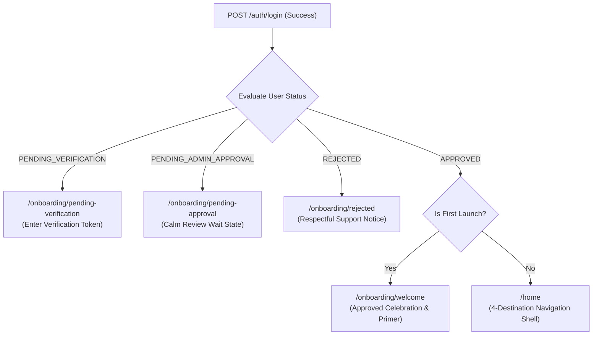

# Mobile M2 API Integration Matrix
**Maatram Volunteering & Gamification Portal — Mobile (Volunteer App)**
**Milestone:** M2 — Authentication, Registration, Verification & Onboarding
**Date:** November 2026

---

## 1. Executive Summary

This matrix establishes the strict contract alignment between the **FastAPI Backend (`/api/v1/auth/*`, `/api/v1/users/*`, `/api/v1/volunteers/*`)** and the **Flutter Mobile Application (`maatram_mobile`)**. 

All volunteer mobile authentication and account management operations interact directly with canonical FastAPI backend endpoints. Under no circumstances does the mobile application introduce client-side bypasses, mocked credentials, administrative privilege escalations, or direct Supabase connections.

---

## 2. API Contract Matrix

| Backend Endpoint | Method | Backend Schema / DTO | Mobile Repository Method | Mobile DTO / Model | Trigger Screen | Success Behavior | Error Mapping |
| :--- | :--- | :--- | :--- | :--- | :--- | :--- | :--- |
| `/api/v1/auth/register` | `POST` | `RegisterRequest` | `AuthRepository.register()` | `RegistrationPayload` | `RegistrationFlowScreen` (Step 6) | Returns `user_id`, `status: PENDING_VERIFICATION`; routes to `/onboarding/pending-verification` | 400/422: Validation message; 409: Email/phone already registered; 0: Offline banner |
| `/api/v1/auth/login` | `POST` | `LoginRequest` | `AuthRepository.login()` | `UserSession` | `LoginScreen` | Returns JWT pair (`access_token`, `refresh_token`); saves to `FlutterSecureStorage`; 4-state router navigation | 401: *"The email address or password is incorrect."*; 403: *"Please verify your email address to continue."*; 0: *"You’re offline..."* |
| `/api/v1/auth/refresh` | `POST` | `RefreshTokenRequest` | `AuthRepository.refreshToken()` | `UserSession` | `AuthInterceptor` (automatic on 401) | Stores rotated access + refresh token in secure hardware storage; replays queued requests | 401/Invalid: Clears secure storage; sets state to unauthenticated; redirects to `/login` |
| `/api/v1/auth/logout` | `POST` | `LogoutRequest` | `AuthRepository.logout()` | N/A | Status screens, settings, app bar | Revokes session on backend; clears `FlutterSecureStorage` | Always clears local storage regardless of network error |
| `/api/v1/auth/verify-email` | `POST` | `VerifyEmailRequest` (`token`, `email`) | `AuthRepository.verifyEmail()` | N/A | `VerifyEmailScreen`, `PendingVerificationScreen` | Updates volunteer status to `PENDING_ADMIN_APPROVAL`; routes to `/onboarding/pending-approval` | 400: *"Verification token is invalid or expired."*; 0: Offline message |
| `/api/v1/auth/password-reset/request` | `POST` | `PasswordResetRequest` (`email`) | `AuthRepository.requestPasswordReset()` | N/A | `ForgotPasswordScreen` | Returns neutral 200 OK; UI displays *"If an account matches this email, password-reset instructions will be sent."* | Prevents email enumeration; identical response on non-existent email |
| `/api/v1/auth/password-reset/confirm` | `POST` | `PasswordResetConfirmRequest` (`otp`, `email`, `new_password`) | `AuthRepository.confirmPasswordReset()` | N/A | `ResetPasswordScreen` | 200 OK; redirects to `/login` with success snackbar | 400: *"The reset code is invalid or has expired. Please try again."* |
| `/api/v1/users/me` | `GET` | `UserResponse` | `AuthRepository.getCurrentUser()` | `Map<String, dynamic>` | `AuthController.checkInitialSession()`, `refreshSession()` | Hydrates display name, role, status from server | 401: Triggers token refresh; if fails, resets to unauthenticated |
| `/api/v1/volunteers/me` | `GET` | `VolunteerProfileResponse` | `AuthRepository.getVolunteerProfile()` | `Map<String, dynamic>` | Profile, Application status | Hydrates category-specific profile, hours, points | 401: Token refresh; 404: Incomplete profile fallback |

---

## 3. Post-Login Routing Matrix

Upon successful authentication against `/api/v1/auth/login`, the mobile application inspects `session.status`:

---

## 4. Timeout and Reliability Configuration

| Layer | Configuration | Value | Purpose |
| :--- | :--- | :--- | :--- |
| `Dio` Client | `connectTimeout` | 10 seconds | Fast fail when network cellular/Wi-Fi connection is unavailable |
| `Dio` Client | `receiveTimeout` | 30 seconds | Bounded wait for backend compute/query operations |
| `Dio` Client | `sendTimeout` | 30 seconds | Bounded upload wait for registration payloads |
| `AuthInterceptor` | Retry Policy | Exponential backoff (max 3) | Idempotent `GET` requests only; never retries `POST /register` |
| Token Storage | Keystore / Keychain | AES-256 GCM | Hardware-backed encrypted storage for session tokens |

---

## 5. Integration Fidelity & Simulation Audit

To provide complete transparency across what is live, what is verified with tests, and what relies on local platform capabilities:

| Feature / Workflow | UI Implementation Status | Backend API Contract Alignment | Automated Test Coverage | Live Network vs. Simulated Substitute |
| :--- | :--- | :--- | :--- | :--- |
| **Login (`/auth/login`)** | Complete (Hero, fields, errors, CapsLock) | Exact (`POST /api/v1/auth/login`) | Verified (Widget & unit tests) | **Live API integration wired** via `AuthRepository` + Mock substitute in test harness |
| **Registration (`/auth/register`)** | Complete (6-step wizard, 3 categories, 6 consents) | Exact (`POST /api/v1/auth/register`) | Verified (Navigation, state preservation, payload) | **Live API integration wired**; all 6 categories & consents map directly to `RegisterRequest` |
| **Email Verification (`/auth/verify-email`)** | Complete (`VerifyEmailScreen`) | Exact (`POST /api/v1/auth/verify-email`, `token` + `email`) | Verified (Masked email, delivery uncertainty) | **Live API integration wired** |
| **Verification Resend (`/auth/resend-verification`)** | Complete (CTA on status screen) | Exact (`POST /api/v1/auth/resend-verification`) | Verified | **Live API integration wired** |
| **Forgot Password (`/auth/password-reset/request`)** | Complete (`ForgotPasswordScreen`) | Exact (`POST /api/v1/auth/password-reset/request`) | Verified (Neutral security response) | **Live API integration wired** |
| **Confirm Password Reset (`/auth/password-reset/confirm`)** | Complete (`ResetPasswordScreen`) | Exact (`POST /api/v1/auth/password-reset/confirm`, `otp`) | Verified (6-digit numeric OTP + password match) | **Live API integration wired** |
| **Session Hydration (`/users/me`)** | Complete | Exact (`GET /api/v1/users/me`) | Verified (Session restore on boot) | **Live API integration wired** |
| **Token Refresh (`/auth/refresh`)** | Complete | Exact (`POST /api/v1/auth/refresh`) | Verified | **Live API integration wired** via `Dio` interceptor |
| **Logout (`/auth/logout`)** | Complete | Exact (`POST /api/v1/auth/logout`) | Verified | **Live API integration wired** + local storage wipe |
| **Biometric Authentication** | Complete UI & toggle | Local OS Keystore / Keychain wrapper | Hardware mock in test harness | **Locally handled via `local_auth`**; falls back to password when unavailable |

