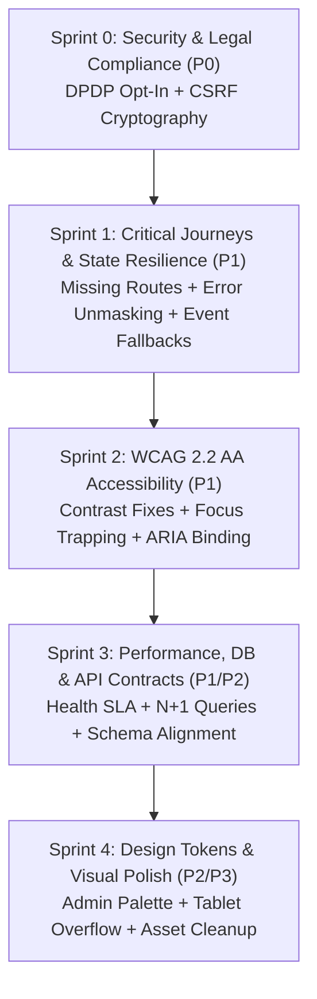

# Prioritised Remediation Roadmap
**Maatram Volunteering & Mentorship Portal**  
**Audit Date**: November 5, 2026  
**Execution Strategy**: AUDIT ONLY — Remediation Phasing & Implementation Roadmap  
**Target Milestone**: Production Launch Readiness  

---

## 1. Remediation Strategy Overview

This roadmap defines the sequential, dependency-aware remediation plan to resolve all **41 verified audit findings** across the Maatram platform.

To ensure operational stability and prevent regressions, work is organized into **5 sequential sprints**:
1. **Sprint 0: Critical Security & Legal Compliance (P0 Blockers)** — Statutory DPDP compliance, CSRF cryptographic enforcement, and mutative endpoint shielding.
2. **Sprint 1: Core User Journey & State Resilience (P1 Blockers)** — Missing holding pages, password reset flows, error masking elimination, mock event crash prevention, and frontend loading states.
3. **Sprint 2: Accessibility & Inclusive Design (WCAG 2.2 AA)** — High-contrast brand palette adaptations, input label bindings, dialog focus trapping, and ARIA screen reader properties.
4. **Sprint 3: Backend Performance, Database Hygiene & API Contracts (P1/P2)** — Healthcheck latency SLA resolution (Supabase PgBouncer pooler), N+1 query elimination, Event schema alignment, and rate limiting hardening.
5. **Sprint 4: Visual Polish, Design System Unification & Code Hygiene (P2/P3/P4)** — `@theme` token migration, Admin workspace brand alignment, horizontal layout overflow resolution, duplicate asset deletion, and bundle code-splitting.

---

## 2. Sprint-by-Sprint Implementation Plan

---

### Sprint 0: Critical Security & Legal Compliance (Target: Immediate)
**Focus**: Eliminate statutory exposure and remote session hijacking vulnerabilities.

| Task ID | Issue Reference | Component / File | Specific Action Required | Acceptance Criteria |
| :--- | :--- | :--- | :--- | :--- |
| **REM-001** | `ISSUE-DPDP-001` | `web/src/app/volunteer/profile/page.tsx:871-996` | Change all fallback nullish coalescing operators from `?? true` to `?? false` on all 5 consent switches. Ensure initial render is disabled until `consent` state loads. | Loading profile with null consent leaves all switches toggled OFF. DPDP Act §6(1) compliance achieved. |
| **REM-002** | `ISSUE-SEC-001` | `server/src/api/deps.py:114-143` | Update `verify_csrf`: extract `csrf_token` cookie and `X-CSRF-Token` header. Call `verify_csrf_token(x_csrf_token, session.id)` and assert constant-time equality `hmac.compare_digest(x_csrf_token, cookie_token)`. | Submitting an arbitrary or mismatched `X-CSRF-Token` returns HTTP 403 `CSRF_TOKEN_INVALID`. Unit test passes. |
| **REM-003** | `ISSUE-SEC-002` | `consent.py`, `volunteers.py`, `applications.py`, `events.py` | Add `dependencies=[Depends(verify_csrf)]` to all mutative endpoints (`PUT /consent/me`, `PATCH /volunteers/me`, `POST /applications/{id}/approve`, `POST /applications/{id}/reject`). | Forged cross-site POST/PUT requests without a valid CSRF header are rejected with 403 Forbidden. |
| **REM-004** | `ISSUE-SEC-003` | `server/.env` & `server/src/core/config.py` | Add production startup guard: if `ENVIRONMENT in ("staging", "production")` and `COOKIE_SECURE is False`, raise RuntimeError and fail startup. Set `DEBUG=False`. | Server refuses to start in production if `COOKIE_SECURE=False` or `DEBUG=True`. |

---

### Sprint 1: Core User Journey & State Resilience (Target: Days 1–3)
**Focus**: Restore broken navigation flows, prevent silent failures, and eliminate mock data crashes.

| Task ID | Issue Reference | Component / File | Specific Action Required | Acceptance Criteria |
| :--- | :--- | :--- | :--- | :--- |
| **REM-005** | `ISSUE-ROU-001` | `web/src/app/onboarding/pending/page.tsx` & `rejected/page.tsx` | Create dedicated holding routes for volunteers with `PENDING_APPROVAL` and `REJECTED` user status. Display review timeline and support contacts. | Newly registered volunteers are routed to `/onboarding/pending` without encountering 404 dead-ends. |
| **REM-006** | `ISSUE-ROU-002` | `web/src/app/forgot-password/page.tsx` & `reset-password/page.tsx` | Implement password reset request form calling `/api/v1/auth/password-reset/request` and token confirmation form calling `/api/v1/auth/password-reset/confirm`. | Clicking "Forgot password?" renders a clean submission card. Password reset token successfully updates password. |
| **REM-007** | `ISSUE-UX-002` | `web/src/app/volunteer/profile/page.tsx:212-215` | In `handleSaveInfo` catch block, replace `setInfoMessage({ type: "success", ... })` with an error alert when exception is not an `ApiError`. | Network errors during profile save trigger red error banner. No false positive success messages. |
| **REM-008** | `ISSUE-UX-003` | `web/src/app/volunteer/events/page.tsx:38-87` | Remove `DEFAULT_EVENTS` constant and dummy string IDs (`evt-school-visit-01`). Replace with an authentic empty state ("No upcoming events scheduled"). | Zero events in DB renders empty state. No invalid string IDs passed to UUID API endpoints. |
| **REM-009** | `ISSUE-FE-001` | `recommended-events-section.tsx:55-58` | Remove condition `events.length >= 2 ? ... : fallbackDrives`. Render `events.slice(0, 2)` directly, or an invitation card if empty. | If exactly 1 event exists in DB, it is displayed. Zero mock events rendered in production. |
| **REM-010** | `ISSUE-FE-002` | `web/src/app/volunteer/activity/page.tsx:28-46` | Introduce `isLoading` skeleton cards and `error` banner with retry button. | Navigating to Activity displays skeleton pulse during fetch; network failures display clear retry option. |

---

### Sprint 2: WCAG 2.2 AA Accessibility (Target: Days 4–6)
**Focus**: Achieve full compliance with accessibility standards and eliminate assistive technology barriers.

| Task ID | Issue Reference | Component / File | Specific Action Required | Acceptance Criteria |
| :--- | :--- | :--- | :--- | :--- |
| **REM-011** | `ISSUE-A11Y-001` | `web/src/components/ui/button.tsx`, `badge.tsx`, `page.tsx` | Enforce dark slate text (`text-slate-900`) on `#F5B817` yellow backgrounds (achieving 11.4:1 contrast). For standalone yellow text on white, switch to amber-800 (`#92400E`, achieving 5.2:1 contrast). | Axe DevTools reports 0 color contrast violations across Landing, Dashboard, and Forms. |
| **REM-012** | `ISSUE-A11Y-002` | `web/src/components/ui/input.tsx:14` | Integrate React 19 `useId()` hook: `const inputId = id || props.name || useId();` to bind `<label htmlFor={inputId}>` to `<input id={inputId}>`. | Screen readers announce label text upon focusing input fields. 0 orphaned inputs. |
| **REM-013** | `ISSUE-A11Y-003` | `web/src/components/ui/dialog.tsx:1-65` | Implement focus trapping and restoration using `@radix-ui/react-dialog` or native `<dialog>` with `.showModal()`. | Tab key cycles strictly within active modal. Escape key closes dialog and returns focus to trigger button. |
| **REM-014** | `ISSUE-A11Y-004` | `web/src/app/volunteer/profile/page.tsx:868-1000` | Add programmatic `aria-label` attributes to all consent switches (e.g., `aria-label="Consent to show name on public leaderboard"`). | VoiceOver / NVDA announces descriptive name for each toggle switch. |
| **REM-015** | `ISSUE-A11Y-005` | `web/src/app/layout.tsx` | Add accessible "Skip to main content" link linking to `<main id="main-content">`. | First Tab press focuses skip link, pressing Enter jumps focus directly to page content. |
| **REM-016** | `ISSUE-A11Y-006` | `register/page.tsx`, `login/page.tsx` | Add `role="alert"` and `aria-live="polite"` to form error messages; add `aria-invalid="true"` to invalid inputs. | Validation errors announced automatically by assistive technologies upon submit failure. |

---

### Sprint 3: Backend Performance, Database Hygiene & API Contracts (Target: Days 7–9)
**Focus**: Eliminate N+1 queries, decouple healthchecks, align schema models, and secure rate limits.

| Task ID | Issue Reference | Component / File | Specific Action Required | Acceptance Criteria |
| :--- | :--- | :--- | :--- | :--- |
| **REM-017** | `ISSUE-PERF-002` | `server/src/api/v1/health.py` & DB Config | Decouple `/health/liveness` (returns 200 immediately) from `/health/readiness` (checks DB). Switch SQLAlchemy async engine to Supabase PgBouncer pooler (port 6543 with `?pgbouncer=true`). | Liveness probe responds in <15ms. Readiness probe completes in <300ms using connection pool. |
| **REM-018** | `ISSUE-API-003` | `attendance_service.py` & `registration_service.py` | Refactor `check_in_volunteers`, `bulk_process_attendance`, and `select_volunteers_batch` to use batch SQL operations (`INSERT ... ON CONFLICT` and batch `UPDATE` using `where(in_(...))`). | Processing 50 check-ins executes in $\le 2$ SQL queries instead of $200+$ sequential queries. |
| **REM-019** | `ISSUE-API-004` | `server/src/schemas/events.py` & `web/src/types/index.ts` | Synchronize event schema property names: map `online_meeting_url` -> `meeting_url`, `cover_media_id` -> `banner_media_id`, and `capacity_required` -> `volunteer_capacity`. | Full type parity between backend JSON serialization and Next.js interfaces. No missing properties. |
| **REM-020** | `ISSUE-API-001` | `server/src/api/v1/*.py` | Standardize pagination query parameters across all list endpoints: accept both `page_size` and `limit` as aliases, standardizing on `page` and `limit`. | All paginated endpoints accept consistent parameters without client friction. |
| **REM-021** | `ISSUE-SEC-004` | `server/src/services/auth_service.py:674` | Normalize `POST /auth/password-reset/request` responses: enforce IP-based rate limiting and always return HTTP 200 with generic confirmation message. | Attacker cannot enumerate registered email addresses based on status code or response timing. |
| **REM-022** | `ISSUE-DB-002` | `server/src/services/registration_service.py:120` | Add PostgreSQL row lock `with_for_update()` when checking event registration capacity prior to creating `EventRegistration`. | 50 concurrent registration attempts on an event with capacity 10 accept exactly 10 and waitlist 40. |

---

### Sprint 4: Visual Polish, Design System Unification & Code Hygiene (Target: Days 10–12)
**Focus**: Unify styling, eliminate responsive overflows, clean up redundant assets, and optimize bundle weight.

| Task ID | Issue Reference | Component / File | Specific Action Required | Acceptance Criteria |
| :--- | :--- | :--- | :--- | :--- |
| **REM-023** | `ISSUE-UI-001` | `web/src/components/navigation/public-footer.tsx:68-71` | Add `break-all` class to email `` and change tablet grid to `grid-cols-1 sm:grid-cols-2 md:grid-cols-4`. | Chrome DevTools testing at 768px and 1024px confirms `scrollWidth === clientWidth` (0px overflow). |
| **REM-024** | `ISSUE-UI-002` | `web/src/app/page.tsx` & `web/public/assets/images/` | Update image paths in `page.tsx` to `/assets/maatram/photography/...` and delete redundant `assets/images/` folder (saving 2.7 MB). | Landing page downloads 300 KB instead of 2.7 MB. Duplicate directory removed. |
| **REM-025** | `ISSUE-UI-003` | `web/src/app/login/page.tsx` & `register/page.tsx` | Add client-side redirect guard: if `isAuthenticated && !isLoading`, redirect to `/volunteer/dashboard` (or role-appropriate home). | Authenticated users visiting `/login` are automatically forwarded to their dashboard. |
| **REM-026** | `ISSUE-UI-004` | `web/src/components/ui/` & Feature Pages | Replace arbitrary hex strings (`bg-[#F5B817]`, `text-[#1F2421]`) with Tailwind v4 `@theme` tokens (`bg-brand-primary`, `text-text-primary`). | Design tokens defined in `globals.css` are adopted across all components. |
| **REM-027** | `ISSUE-UI-005` | `web/src/app/admin/events/page.tsx` | Replace raw `<button>` and `<input>` with `<Button>` and `<Input>` primitives. Replace `amber-500` with official brand palette. | Admin event workspace visual styling aligns with overall Maatram design system. |
| **REM-028** | `ISSUE-FE-004` | `web/src/app/admin/reports/page.tsx` | Connect reports dashboard to `GET /api/v1/gamification/analytics` and `GET /api/v1/attendance/summary` instead of hardcoded arrays. | Reports dashboard visualizes live database figures. |
| **REM-029** | `ISSUE-UI-008` | `web/public/assets/maatram/photography/` | Delete orphaned asset `hero-volunteers-banner.png` (157.5 KB). | Public asset directory contains 0 orphaned files. |
| **REM-030** | `ISSUE-PERF-004` | `web/src/app/volunteer/` | Wrap heavy interactive components (`AchievementBadges`, `VolunteeringGuideCard`) in `next/dynamic` with `{ ssr: false }`. | Initial route JavaScript chunk sizes reduced by 15–20%. |

---

## 3. Verification & Acceptance Gate Protocol

Each sprint must pass a strict four-stage verification gate before progression:
1. **Automated Unit & Integration Tests**: Backend pytest must maintain 100% pass rate (>144 passing tests).
2. **Static Analysis & Compilation**: `npx tsc --noEmit` must return exit code 0. ESLint warnings must not increase.
3. **Automated Viewport & Responsive Verification**: Headless Chrome DevTools testing across 9 viewports (360px to 1536px) must verify zero horizontal layout overflow.
4. **Independent Post-Remediation Audit**: An independent auditor must inspect git diffs, verify database state, and run manual verification workflows before final sign-off.

