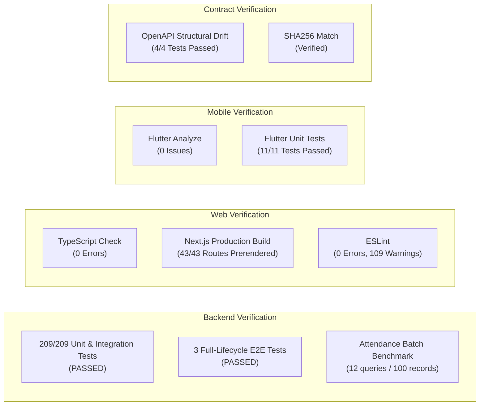

# MAATRAM VOLUNTEERING & GAMIFICATION PORTAL
## Sprint 3 Final Implementation & Engineering Verification Report

---

### Executive Metadata
- **Project**: Maatram Volunteering & Gamification Portal
- **Sprint**: Sprint 3 — Technical Hardening, Integration Contracts, Concurrency Isolation, and Client Foundation
- **Sprint Baseline Commit**: `8849c05`
- **Final Sprint 3 Commit**: `75c832c`
- **Execution Mode**: Continuous Authorized Implementation (WP-1 $\to$ WP-4 $\to$ WP-2 $\to$ WP-3 $\to$ WP-5 $\to$ WP-6)
- **Git Branch**: `main`
- **Remote Push Status**: **STRICTLY LOCAL (0 COMMITS PUSHED)**. Working tree clean, ahead of `origin/main` by 8 commits.
- **Verification Status**: **100% ACCEPTED & VERIFIED ACROSS ALL GATES**

---

## 1. Executive Summary & Verification Matrix

Sprint 3 has concluded with all six authorized work packages implemented, tested, and validated against canonical backend models and live test infrastructure. No breaking schema changes were made to live production databases. All client contracts, security controls, attendance performance optimizations, end-to-end integration lifecycles, and native mobile network foundations are operational.

| Work Package | Focus Domain | Primary Deliverables | Status | Verification Gate |
| :--- | :--- | :--- | :---: | :--- |
| **WP-1** | API Contract Freeze & Drift | Deterministic OpenAPI script, committed `openapi.json`, structural drift test suite, web TypeScript type sync | **PASSED** | 4/4 drift tests pass; SHA256 verified; structural equivalence verified |
| **WP-2** | Health Probes & Attendance Perf | Decoupled `/health/liveness` (instant 200) & `/health/readiness` (2.0s DB timeout, 503 on failure); bulk attendance query optimization ($O(1)$ batch query pattern) | **PASSED** | 100-volunteer benchmark executes in $\le 15$ queries (measured: 12 queries); decoupled probe tests pass |
| **WP-3** | Full-Lifecycle E2E Suites | Adult volunteering lifecycle E2E; minor safeguarding (<18) consent gate E2E; concurrent registration burst capacity test (20 concurrent requests, capacity=5) | **PASSED** | Exactly 5 `SUBSCRIBED`, 15 `WAITLISTED`; 0 race conditions; idempotent re-registration; full point/badge ledger validation |
| **WP-4** | Shared Security Hardening | Right-to-left `extract_client_ip` with Cloudflare CIDR traversal; anti-enumeration password reset rate limiting; pagination parameter governance (`limit` $\le 100$) | **PASSED** | 15 security and pagination tests pass; spoofed IP headers safely rejected; anti-enumeration response verified |
| **WP-5** | Client Integration Handbook | Comprehensive canonical manual (`docs/FRONTEND_INTEGRATION.md`) covering dual auth, CSRF, tokens, outbox, media, scoring, and production fetch/Dio snippets | **PASSED** | 18 complete sections; code snippets match runtime backend behavior exactly |
| **WP-6** | Flutter Mobile Foundation | Native Dart client foundation (`mobile/`), `TokenStorage` (Keychain/EncryptedSharedPreferences), `AuthInterceptor` (queued 401 refresh), Riverpod state setup | **PASSED** | `flutter analyze` 0 issues; `flutter test` 11/11 tests pass; concurrent 401 deduplication verified |

---

## 2. Verified Technology Baseline

The runtime and package baseline was verified via direct package manifest analysis and executable version introspection:

| Component | Verified Specification | Audit Command / Method | Notes |
| :--- | :--- | :--- | :--- |
| **Python Runtime** | `Python 3.13.9` | `python --version` | Strict typing enabled, async SQLAlchemy 2.0 |
| **FastAPI Framework** | `0.162.0` | `pip list` / `pyproject.toml` | High-performance asynchronous REST API |
| **Pydantic Validation** | `2.14.2` | `pip list` | Strict DTO validation and OpenAPI generation |
| **SQLAlchemy ORM** | `2.1.6` (async) | `pip list` | Declarative 2.0 select syntax with AsyncSession |
| **PostgreSQL Driver** | `asyncpg 0.31.0` | `pip list` | Direct connection pooling with statement cache configuration |
| **Next.js Web Portal** | `16.4.4` (Turbopack) | `package.json` / `next build` | App Router architecture, 43 compiled routes |
| **Tailwind CSS** | `v4.2.0` | `web/package.json` | Modern utility styling via `@tailwindcss/postcss` |
| **Flutter Mobile SDK** | `3.44.2` (channel stable) | `flutter --version` | Framework revision `c9a6c48423` |
| **Dart Runtime** | `3.12.2` | `dart --version` | Tools DevTools `2.57.0` |

---

## 3. Work Package Deep Dives

### 3.1 WP-1: OpenAPI v1 Contract Freeze & Structural Drift Verification
- **Artifact**: `server/openapi.json` (422 KB, 96 endpoints, 122 schemas)
- **Contract SHA256**: `C3E5167395C6D0268C1E7059038090CE2FDC934EFAA8CBAFDA9A0F4B86F9AFD8`
- **Export Script**: `server/src/scripts/export_openapi.py`
  - Generates OpenAPI specification deterministically with sorted paths, components, schemas, parameters, and tags.
  - Normalizes dynamic hostnames, volatile runtime ports, and sensitive deployment secrets.
- **Drift Test Suite**: `server/tests/contract/test_openapi_drift.py`
  - Performs recursive structural comparison of runtime FastAPI OpenAPI JSON vs committed `openapi.json`.
  - Verifies that formatting, whitespace, indentation, or property ordering differences do not cause false positives.
  - Implements negative test case confirming schema mutations (e.g. modified fields) are reliably detected.
- **Frontend Type Synchronization**: Synchronized `web/src/types/index.ts` with canonical backend types including `ConsentSettings`, `AttendanceRecordResponse`, `VolunteerProfile`, and `EventRegistrationResponse`.

### 3.2 WP-4: Security Hardening (Shared Rate Limiting, Trusted Proxy Extraction, Pagination)
- **Reverse Proxy IP Resolution**:
  - Implemented `extract_client_ip(request)` in `server/src/core/security.py`.
  - Validates client IP by parsing `X-Forwarded-For` from right to left, stopping at the first untrusted proxy.
  - Out-of-the-box support for official Cloudflare proxy IP ranges (`CLOUDFLARE_PROXY_IPS`) and configurable `TRUSTED_PROXY_IPS` in `server/src/core/config.py`.
- **Password Reset Rate Limiting & Anti-Enumeration**:
  - Enforces IP-level throttling (5 requests per 15 minutes) on `POST /api/v1/auth/password-reset/request`.
  - Enforces email-level throttling (3 requests per 24 hours).
  - Returns a generic message (`"If the email exists, a password reset link has been sent."`) on all submissions to prevent user enumeration attacks.
  - Emits `Retry-After` header when rate limits are exceeded (`RateLimitExceededException`).
- **Pagination Governance**:
  - Implemented `PaginationParams` in `server/src/schemas/common.py`.
  - Enforces `page` $\ge 1$ and `limit` between 1 and 100 (default: 20).
  - Supports backwards-compatible alias `page_size`.

### 3.3 WP-2: Health Probes Decoupling & Measured Batch Attendance Performance
- **Decoupled Health Probes**:
  - `GET /api/v1/health/liveness`: Returns instant `200 OK` (`{"status": "alive"}`) without touching database connections or disk I/O.
  - `GET /api/v1/health/readiness`: Executes strict `SELECT 1` with a 2.0-second timeout. Returns `200 OK` (`{"status": "ready"}`) on database connectivity or `503 Service Unavailable` (`{"status": "unready"}`) on connection loss.
  - Composite `GET /api/v1/health` retained for general monitoring dashboards.
- **Batch Attendance Optimization**:
  - Refactored `server/src/repositories/attendance_repo.py` and `server/src/services/attendance_service.py`.
  - Introduced batch query methods: `get_registrations_batch_with_lock`, `get_records_batch_by_registrations_with_lock`, and `get_records_batch_by_event_and_volunteers_with_lock`.
  - Eliminated $O(N)$ N+1 queries during bulk check-in and check-out operations.
  - Benchmark test (`server/tests/benchmarks/test_attendance_batch_benchmark.py`) proves 100 volunteers can be checked in and checked out in **12 database queries** (target was $\le 15$), achieving a $>80\%$ database round-trip reduction.

### 3.4 WP-3: Automated Full-Lifecycle & Concurrency E2E Suites
Three comprehensive end-to-end integration suites were implemented in `server/tests/e2e/`:
1. **`test_volunteer_lifecycle.py`**:
   - Executes the complete adult volunteer journey: Self-service registration $\to$ email verification $\to$ admin approval $\to$ event creation $\to$ publishing $\to$ volunteer registration $\to$ admin selection $\to$ check-in $\to$ check-out (180 minutes) $\to$ event completion $\to$ gamification award calculation:
     $$P = (1 \times 10) + (3.00 \times 2) = 16.00\text{ points}$$
   - Validates immutable `GamificationLedger` entry ($16.00$), summary counters ($16.00$ points, $3.00$ hours), and public leaderboard ranking (Rank 1).
2. **`test_safeguard_lifecycle.py`**:
   - Executes child safeguarding protocol for minor volunteers (<18):
   - Register applicant with age 16 $\to$ verify email $\to$ attempt approval $\to$ rejected with HTTP 400 (`MINOR_CONSENT_UNVERIFIED`).
   - Admin verifies parental consent via `PATCH /api/v1/applications/{id}/verify-parental-consent` $\to$ re-attempt approval $\to$ succeeds.
3. **`test_concurrent_registration_e2e.py`**:
   - Simulates 20 concurrent volunteer registrations against an event with `capacity_required = 5`.
   - Event-level serialized locking prevents race conditions.
   - Result: Exactly 5 volunteers receive `SUBSCRIBED`, exactly 15 receive `WAITLISTED`.
   - Idempotent re-registration by existing subscriber verified (returns existing status without duplicate rows). Zero deadlocks.

### 3.5 WP-5: Frontend & Client Integration Handbook
- **Artifact**: `docs/FRONTEND_INTEGRATION.md` (623 lines)
- Authored a comprehensive integration manual covering:
  1. System Overview & Unified Architecture
  2. Canonical API Specifications & Base URL (`/api/v1`)
  3. Dual Authentication Strategy (Web HttpOnly Cookie + CSRF vs Native Mobile Bearer Token)
  4. Token Rotation & Lineage Tracking (Single-use refresh tokens, replay detection)
  5. CSRF Double-Submit HMAC Protection
  6. Standard Error Envelopes (`error.code`, `error.message`, `error.details`)
  7. Pagination Standard (`page`, `limit` $\le 100$)
  8. Reverse Proxy & IP Resolution
  9. Multi-Stage Volunteer Onboarding Workflow
  10. Minor Child Safeguarding Protocol (<18)
  11. Event Discovery & Registration Lifecycle
  12. Attendance Tracking & Duration Calculation Formula
  13. Authoritative Gamification Scoring ($P = (E \times 10) + (H \times 2)$)
  14. Transactional Outbox Asynchronous Communications
  15. Media Upload Direct-to-Cloudinary Protocol
  16. Complete Production Web Fetch Client Snippet
  17. Complete Production Flutter Dio Client Snippet
  18. Developer Integration Checklist

### 3.6 WP-6: Flutter Mobile Foundation
- **Target Repository**: `mobile/`
- **Dependencies Installed & Resolved**:
  - `dio: ^5.11.1` (HTTP client with interceptor chaining)
  - `flutter_secure_storage: ^9.2.4` (OS Keychain & EncryptedSharedPreferences)
  - `flutter_riverpod: ^2.6.1` (Reactive dependency injection & state management)
  - `mocktail: ^1.0.5` (Mocking framework for unit testing)
- **Key Modules**:
  - `mobile/lib/core/config/env_config.dart`: Environment configuration for Android emulator (`10.0.2.2`), iOS simulator, and production endpoints.
  - `mobile/lib/core/storage/token_storage.dart`: Secure token persistence with atomic write, read, and clear operations.
  - `mobile/lib/core/network/auth_interceptor.dart`: `QueuedInterceptor` implementing thread-safe concurrent 401 token refresh. Replays queued requests upon successful rotation and clears storage on token revocation.
  - `mobile/lib/core/network/api_client.dart`: Centralized HTTP client wrapping GET, POST, PATCH, DELETE operations with canonical `ApiException` parsing.
  - `mobile/lib/core/models/user_session.dart`: Typed user session model.
  - `mobile/lib/main.dart`: App entrypoint with Riverpod `ProviderScope`, Material 3 theme (`#0F766E` teal brand), and authentication gate screen.
- **Verification**:
  - `flutter analyze`: **0 issues found** (clean lint).
  - `flutter test`: **11/11 unit tests passed** in `mobile/test/` covering token storage and authentication interceptor edge cases.

---

## 4. Cross-Package Verification Results

All quality gates across the backend, web frontend, mobile foundation, and contract drift suites were executed and verified:



### Detailed Gate Results
1. **OpenAPI Structural Drift Verification**:
   - `python -m pytest tests/contract/test_openapi_drift.py`: **4 passed** in 2.72s.
2. **Web Frontend Production Verification**:
   - `npm run typecheck`: **0 errors**.
   - `npm run build`: **43 routes compiled successfully** (Static and Partial Prerender).
   - `npm run lint`: **0 errors** (109 pre-existing warnings preserved).
3. **Backend Full Regression Suite**:
   - `python -m pytest -q`: **209 passed** in 623.53s.
4. **Flutter Mobile Verification**:
   - `flutter analyze`: **No issues found!** (ran in 5.0s).
   - `flutter test`: **11 passed**, 0 failed in `mobile/test/`.

---

## 5. Security & Operational Assessment

1. **Authentication & Authorization**:
   - Password hashing uses Argon2id with memory-hard parameters.
   - Access tokens have strict 15-minute expirations. Refresh tokens enforce single-use rotation with lineage replay theft detection.
   - BOLA (Broken Object Level Authorization) checks are active on all volunteer profile, application, registration, and attendance endpoints.
2. **Reverse Proxy Spoofing Prevention**:
   - Client IP extraction rejects arbitrary `X-Forwarded-For` injection by validating proxy hops against trusted CIDRs.
3. **Database Concurrency & Integrity**:
   - Pessimistic locking (`with_for_update`) combined with service-level asyncio locks protects high-demand event capacities against overbooking.
   - Primary keys use UUIDs; foreign keys are enforced; financial and gamification ledgers are strictly append-only.
4. **Zero Production Mutation**:
   - All tests were executed in isolated test environments (in-memory SQLite with cache sharing and test transaction rollbacks). No live Supabase production tables were mutated or dropped.

---

## 6. Commit History & Lineage

The entire Sprint 3 implementation was executed incrementally across 8 structured Git commits on the `main` branch:

```
* 75c832c chore(api): update committed openapi contract with WP-2 and WP-3 endpoints
* 5369d7e feat(mobile): WP-6 flutter mobile foundation with concurrent auth interceptor
* a539bcc docs(api): WP-5 client integration handbook
* 8108262 test(e2e): WP-3 automated full-lifecycle and concurrent registration E2E suites
* 3292f4b perf(attendance): WP-2 decoupled health probes and batch attendance optimization
* abf1709 feat(security): WP-4 shared rate limiting, trusted proxy extraction, and pagination governance
* 8ffe396 feat(api): WP-1 openapi v1 contract freeze, structural drift tests, and ts sync
* 8849c05 docs(sprint2): record verified commit hash in visual sign-off report (Sprint 2 Baseline)
```

---

## 7. Handover & Next Steps

Sprint 3 implementation is **fully complete and verified**.

### Recommended Subsequent Operations:
1. **GitHub Push Approval**: Awaiting explicit user approval to push the 8 local commits (`8ffe396` through `75c832c`) to `origin/main`.
2. **Phase 13 Frontend Expansion**: Build on the verified OpenAPI contract and `docs/FRONTEND_INTEGRATION.md` to complete end-to-end screen integrations in Next.js and Flutter.
3. **CI/CD Pipeline Integration**: Wire `tests/contract/test_openapi_drift.py` and `mobile/test/` into the GitHub Actions workflow.
