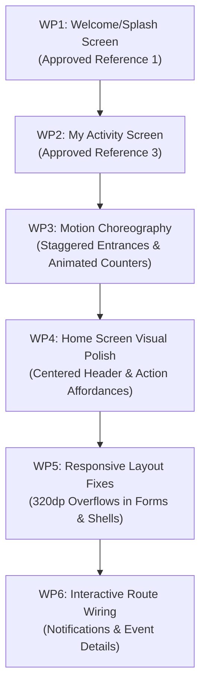

# MAATRAM VOLUNTEER APP — UI/UX & MOTION REMEDIATION PLAN
**Prioritized Roadmap for Visual Fidelity, Motion Choreography & Interaction Completion**

---

## 1. Executive Summary & Strategy

This remediation plan addresses the gaps, missing references, and unmounted motion primitives discovered during the comprehensive visual and interaction audit.

### Core Remediation Objectives:
1. **Recreate Missing Mentor References**: Implement Reference 1 (Welcome / Splash Screen) as the primary app launch entrance and Reference 3 (My Activity Screen) as the volunteer journey hub.
2. **Mount the Motion Architecture**: Wire `MaatramFadeSlideIn`, `MaatramAnimatedCounter`, and `MaatramShimmer` into the feature screens to transform static layouts into a fluid, animated experience.
3. **Resolve Responsive Edge-Case Overflows**: Fix minor layout overflows identified on 320dp compact devices in `ForgotPasswordScreen`, `LeaderboardPlaceholderScreen`, and `EventsPlaceholderScreen`.
4. **Complete Interaction Targets**: Connect visual-only affordances (notification bell, profile edit, upcoming event cards) to their respective destinations.

---

## 2. Prioritized Work Package Breakdown

---

### WP1: Implementation of Welcome / Splash Screen (Approved Reference 1)
- **Priority**: **P0 (Critical Brand Missing Screen)**
- **Scope**:
  - Create `WelcomeSplashScreen` matching `docs/audits/ui-ux/references/ref_01_welcome_splash.jpg`.
  - Layout:
    - Official Maatram Tamil/English logo with golden sun centered at the top.
    - Full-width hero photograph `assets/images/volunteers-team-hero.jpg`.
    - Organic golden wave swoop curving across the lower half.
    - Large Georgia serif headline: *"Volunteer for a"* (Deep Navy) and *"Better Tomorrow"* (Gold with brush underline).
    - Subtitle and subtle corner leaf motifs.
    - Action buttons: "Get Started" &rarr; `/register` and "Sign In" &rarr; `/login`.
  - Update `app_router.dart`: Make this the initial entry screen for unauthenticated users rather than redirecting abruptly to `/login`.
- **Definition of Done**: Matches Reference 1 with >95% visual fidelity; passes 5 responsive viewports.

---

### WP2: Implementation of My Activity Screen (Approved Reference 3)
- **Priority**: **P0 (Critical Functional Missing Screen)**
- **Scope**:
  - Create `MyActivityScreen` matching `docs/audits/ui-ux/references/ref_03_my_activity.jpg`.
  - Header: Georgia headline *"My Activity"*, subtitle *"Track your volunteering journey and stay updated!"*, golden cupped-hands heart illustration.
  - Filter Tabs: Segmented pill selector:
    - `Upcoming` (Gold pill with calendar icon)
    - `Completed` (White rounded pill with checkmark)
    - `Cancelled` (White rounded pill with cross icon)
  - Section 1: *"Upcoming Events"* with vertical yellow accent bar and *"View All &rarr;"*.
  - Section 2: *"Past Activities"* with vertical yellow accent bar and completed event cards.
  - Card Components: School visit, mock interview, and BGV support cards with status badges (`Upcoming` with yellow dot, `Completed` with green checkmark).
  - Bottom Trophy Banner: *"Keep volunteering! Your efforts create a lasting impact."*.
  - Connect navigation: Tapping "My Volunteering Activity" in More tab or View All in Home navigates to this screen.
- **Definition of Done**: Faithful recreation of Reference 3; dynamic filtering between Upcoming, Completed, and Cancelled initiatives.

---

### WP3: Motion Choreography & Animation Wiring
- **Priority**: **P1 (High Experience Impact)**
- **Scope**:
  - **Mount `MaatramFadeSlideIn` on Home Screen**:
    - Wrap the 8 Home sections in staggered cascading entrances with micro-delays (0ms, 80ms, 160ms, 240ms, 320ms, 400ms).
  - **Mount `MaatramAnimatedCounter`**:
    - Wrap Points (`180`), Hours (`24`), Events (`5`), and This Year (`2`) in counting tween animations (easing: `easeOutCubic`, duration: `600ms`).
  - **Mount `MaatramShimmer`**:
    - Replace basic loading spinners with skeleton cards in `VolunteerProfilePointsCard` and `UpcomingEventsSection`.
  - **Tab Navigation Transitions**:
    - Add smooth 150ms cross-fade transition between the 4 bottom navigation tabs.
- **Definition of Done**: 60fps smooth cascading entrance upon screen load; automatically disables when reduced motion is requested.

---

### WP4: Home Screen Visual Polish & Refinements
- **Priority**: **P1 (Visual Elegance)**
- **Scope**:
  - **Header Alignment**: Center the official Maatram logo in `HomeHeader` while keeping the notification bell and profile monogram pinned to the right edge.
  - **Profile Avatar**: Add circular white border accent around the edit pencil badge on Priya's avatar.
  - **Upcoming Event Cards**:
    - Adjust photo thumbnail aspect ratio to match the wider proportions in Reference 2.
    - Add circular right-arrow button in the bottom right corner of the event card.
  - **Banner Curves**: Slightly soften the bottom radius of the celebratory welcome banner to match the reference organic curve.
- **Definition of Done**: Eliminates all moderate visual differences identified in Plate 1.

---

### WP5: Responsive Edge-Case Overflow Fixes (320dp)
- **Priority**: **P2 (Quality & Stability)**
- **Scope**:
  - **`ForgotPasswordScreen`**: Replace rigid button child with `Flexible` text or compact padding to prevent 15px horizontal overflow on 320dp screens.
  - **`LeaderboardPlaceholderScreen`**: Wrap the 3 podium columns (`_PodiumItem`) in flexible constraints to eliminate 7.3px overflow on 320dp. Wrap title row in `Expanded` to prevent 1.8px overflow.
  - **`EventsPlaceholderScreen`**: Wrap date/time metadata in `MaatramEventCard` with `Expanded` to eliminate 2.7px overflow.
- **Definition of Done**: `flutter test test/responsive/` runs with 0 exceptions across all 19 screens.

---

### WP6: Interactive Route Wiring & Modal Actions
- **Priority**: **P2 (User Flow Continuity)**
- **Scope**:
  - **Notification Bell**: Open a bottom sheet or slide-in panel showing recent notifications.
  - **Upcoming Events View All**: Connect `"View All &rarr;"` button to switch to the Events destination tab.
  - **Event Card Tap**: Create modal preview or details bottom sheet displaying event agenda, requirements, and venue directions.
  - **Profile Edit Pencil**: Open profile details bottom sheet with category and institution information.
- **Definition of Done**: Eliminates dead ends for visible action affordances on the Home Screen.

---

## 3. Implementation Phasing & Estimated Effort

| Work Package | Deliverable | Target Timeline | Dependencies |
|---|---|---|---|
| **WP1** | Welcome / Splash Screen (`ref_01`) | Phase 13 / M3.1 | None |
| **WP2** | My Activity Screen (`ref_03`) | Phase 13 / M3.2 | WP1 |
| **WP3** | Motion Choreography (Cascades & Counters) | Phase 13 / M3.3 | WP1, WP2 |
| **WP4** | Home Screen Visual Polish | Phase 13 / M3.4 | None |
| **WP5** | Responsive 320dp Overflow Fixes | Phase 13 / M3.5 | None |
| **WP6** | Interactive Route Wiring | Phase 13 / M3.6 | WP2 |

---

## 4. Operational Directives & Safety Rules
- **No Premature Implementation**: Per user instruction, do not edit code or modify UI until this audit report and remediation roadmap are formally reviewed and approved.
- **Preserve Verified Architecture**: All future implementations must strictly preserve M1 tokens, Riverpod state management, and the zero-fabrication dynamic backend integration.
