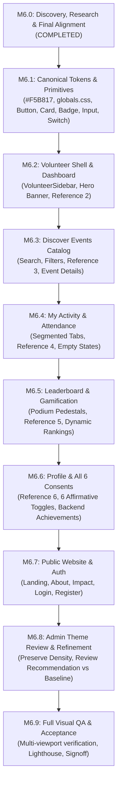

# M6_IMPLEMENTATION_ROADMAP.md — Phased UI/UX Redesign Roadmap
**Maatram Volunteering & Gamification Portal**  
**Milestone 6.0: Execution Phases, Risk Management & Handover Protocol**  
**Date:** November 2026 (Updated with Alignment Corrections)  
**Status:** **ALIGNED IMPLEMENTATION BLUEPRINT — AWAITING USER APPROVAL**

---

## 1. Executive Summary & Implementation Sequence

The UI/UX transformation will be executed in **nine discrete, incremental sub-milestones (Phase 6.1 through Phase 6.9)**. 

This phased approach prevents monolithic regressions, preserves all existing backend API contracts and Milestone 5 performance optimizations, and provides clear verification checkpoints after every batch of redesigned pages.

---

## 2. Detailed Sub-Milestone Execution Plans

### Phase 6.1: Canonical Design Tokens, Global CSS & UI Primitives
- **Objective**: Establish the canonical design tokens in `web/src/app/globals.css` with resolved brand gold (`--color-brand-primary: #F5B817`) and restyle all core UI atoms in `web/src/components/ui/`.
- **Target Files**:
  - `web/src/app/globals.css` (Canonical tokens: `#F5B817`, hover `#E5A800`, active `#C99200`, text `#946C00`, canvas `#FAF8F5`, borders `#EFECE6`).
  - `web/src/components/ui/button.tsx` (Add rounded-full/rounded-xl, golden fill `#F5B817`, right arrow transitions, tactile press feedback).
  - `web/src/components/ui/card.tsx` (Pure white `#FFFFFF`, `rounded-2xl` / `rounded-3xl`, soft warm border `#EFECE6`, ambient shadow).
  - `web/src/components/ui/badge.tsx` (Soft pastel fills matching mentor references).
  - `web/src/components/ui/input.tsx` (Padded inputs with warm focus rings).
  - `web/src/components/ui/switch.tsx` (Golden active track `#F5B817` to match consent toggles).
- **Verification Gate**: Inspect component gallery at `/showcase` across desktop and mobile.

### Phase 6.2: Volunteer Shell & Volunteer Dashboard (*Reference 2*)
- **Objective**: Implement the floating white sidebar rail, top header bar, and the complete Volunteer Dashboard.
- **Target Files**:
  - `web/src/components/navigation/volunteer-sidebar.tsx` (Floating white card, golden pill active item, leaf flourish watermark, user card, helpdesk link).
  - `web/src/components/navigation/volunteer-shell.tsx` (Clean desktop topbar, mobile drawer).
  - `web/src/app/volunteer/dashboard/page.tsx` (Curved golden welcome banner, 4 KPI cards, participation empty state with 3D calendar, recently viewed opportunities, volunteering guide with hand-heart graphic, progress donut ring).
- **Verification Gate**: Compare captured `1536×1024` desktop screenshot against `ui-Reference/Dashboard.jpeg`.

### Phase 6.3: Volunteer Discover Events & Event Details (*Reference 3*)
- **Objective**: Redesign the event discovery interface and detailed event application page.
- **Target Files**:
  - `web/src/app/volunteer/events/page.tsx` (Golden hero banner, full-width search input card, category filter pills, horizontal opportunity cards with authentic photos and category tags).
  - `web/src/app/volunteer/events/[id]/page.tsx` (2-column event detail layout, logistical metadata, agenda, register/withdraw actions).
- **Verification Gate**: Compare captured `1536×1024` desktop screenshot against `ui-Reference/Discover_Events.jpeg`.

### Phase 6.4: Volunteer Activity & Points Ledger (*Reference 4*)
- **Objective**: Implement the volunteer activity timeline and points ledger.
- **Target Files**:
  - `web/src/app/volunteer/activity/page.tsx` (Golden hero banner, segmented tab pill bar: `Upcoming`, `Ongoing`, `Past`, `Points Ledger`, 3D calendar/clock empty state, immutable ledger table).
- **Verification Gate**: Compare captured `1536×1024` desktop screenshot against `ui-Reference/MyActivities.jpeg`.

### Phase 6.5: Volunteer Leaderboard & Gamification (*Reference 5*)
- **Objective**: Implement the gamified community leaderboard and top-3 podium with dynamic backend data.
- **Target Files**:
  - `web/src/app/volunteer/leaderboard/page.tsx` (Golden hero banner with crown and crowd illustration, category filter pills, year dropdown, top-3 physical podium pedestals in gold/silver/bronze, highlighted user rank row in ranking table).
- **Verification Gate**: Compare captured `1536×1024` desktop screenshot against `ui-Reference/Leaderboard.jpeg`.

### Phase 6.6: Volunteer Profile & Privacy Consents (*Reference 6*)
- **Objective**: Reconstruct the profile management page accounting for **all six independent affirmative consent preferences** and dynamic backend achievements.
- **Target Files**:
  - `web/src/app/volunteer/profile/page.tsx` (Golden accent header, left identity card with avatar and mini KPIs, right tabbed form panels, 6 independent affirmative consent switches bound to `ConsentRecord`, dynamically rendered achievement badges).
- **Verification Gate**: Compare captured `1600×900` desktop screenshot against `ui-Reference/Profile_page.jpeg`; verify individual server persistence of all 6 consents via `PUT /consents/me`.

### Phase 6.7: Public Website & Authentication
- **Objective**: Extend the warm ivory/golden visual language across the public web experience.
- **Target Files**:
  - `web/src/app/page.tsx` (Public Landing Page hero and storytelling).
  - `web/src/app/about/page.tsx`, `web/src/app/impact/page.tsx`, `web/src/app/events/page.tsx`.
  - `web/src/app/login/page.tsx`, `web/src/app/register/page.tsx`, `web/src/app/register/confirmation/page.tsx`.
- **Verification Gate**: Verify multi-viewport responsiveness (375px to 1440px) and auth flow integrity.

### Phase 6.8: Admin Portal Theme Review & Operational Refinement
- **Status**: **DESIGN RECOMMENDATION UNDER REVIEW**
- **Objective**: Conduct a theme comparison with stakeholders (Current Dark Slate `#16171A` vs Recommended Harmonized Warm Stone `#1C1D21` / `#FAF8F5`). Only upon explicit approval, apply visual refinements while strictly preserving 100% of operational data density, table compactness, and workflow triage efficiency.
- **Target Files**:
  - `web/src/components/navigation/admin-sidebar.tsx`, `web/src/components/navigation/admin-shell.tsx`.
  - `web/src/app/admin/*` (Dashboard, Applications, Volunteers, Events, Reports, Operations, Settings).
- **Verification Gate**: Verify zero loss of data density in application review, QR attendance, and Excel export workflows.

### Phase 6.9: Visual QA, Performance Benchmarking & Final Signoff
- **Objective**: Comprehensive cross-browser and multi-device verification.
- **Tasks**:
  - Chrome DevTools Lighthouse audit (Performance ≥ 90, Accessibility = 100).
  - Side-by-side overlay diffing against all 5 mentor references.
  - Verification that all 144 backend tests continue to pass with zero regressions.
- **Verification Gate**: Full milestone delivery report and artifact signoff candidate.

---

## 3. Risk Assessment & Mitigation Strategies

| Potential Risk | Severity | Mitigation Strategy |
| :--- | :--- | :--- |
| **Animation Variant Failures** | High | Strictly test that every Framer Motion container specifies defined initial/animate states (`hidden`/`visible`). Avoid blocking opacity on critical content. |
| **Accidental API / Contract Drift** | High | Frontend redesign must treat backend endpoints as black boxes. Do not modify DTO field names, query parameters, or URL endpoints. |
| **Consent Desynchronization** | High | Ensure all 6 affirmative consent fields are independently bound to `ConsentRecord`. Never combine or omit any preference. |
| **Hardcoded Gamification Logic** | Medium | UI dynamically renders achievements returned from backend API (`VolunteerAchievement`); medal artwork in references is treated strictly as visual examples. |
| **Performance Degradation (CLS / LCP)** | Medium | Use Next.js `next/image` with explicit aspect ratios for all hero banners and event thumbnails; maintain Milestone 5 SWR request deduplication. |
| **Contrast Inaccessibility** | Medium | Strictly enforce dark text (`#1F2421`) on yellow fills; never use light yellow text on white/cream backgrounds. |

---

## 4. Unresolved Decisions & Alignment Gates

1. **Admissions Guidance & Panel Interview Photography**:
   - For Admissions Guidance and Panel Interview drives, authenticate that commercial-use licensed or foundation-owned photos matching the visual style of the first three drives will be curated during M6.3.
2. **Admin Portal Theme Decision Gate**:
   - The admin restyling is preserved as an optional recommendation. Baseline dark theme remains operational until explicit stakeholder approval prior to Phase 6.8.
3. **Artwork Sourcing**:
   - Vector illustrations for empty state calendars, hand-heart graphics, and medals will be authored as bespoke SVG/PNG components in M6.1–M6.5, strictly avoiding third-party unlicensed dependencies.
