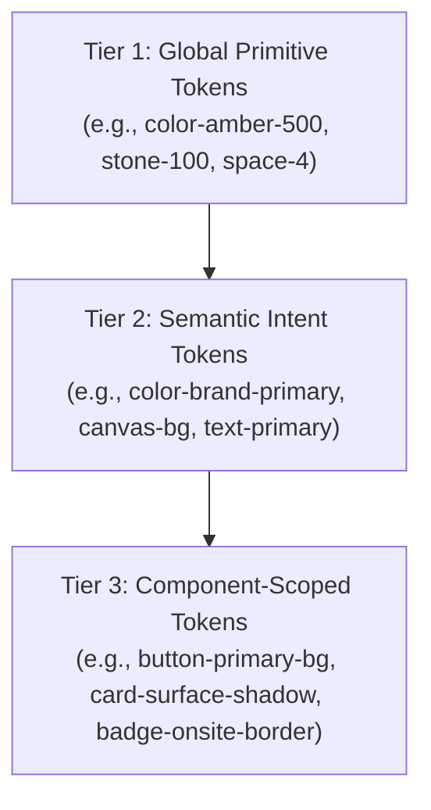

# M6_INDUSTRY_RESEARCH.md — UI/UX Industry Research & Design Methodology
**Maatram Volunteering & Gamification Portal**  
**Milestone 6.0: Design Discovery & UI/UX Transformation**  
**Author:** Antigravity Senior Product Design & Design Systems Architecture Team  
**Date:** November 2026 (Updated with Alignment Corrections)  
**Status:** **APPROVED FOR PLANNING & ARCHITECTURAL GUIDANCE**

---

## 1. Executive Summary & Purpose

The purpose of this research is to establish a rigorous, evidence-based foundation for transforming the Maatram Volunteering & Gamification Portal from a functional prototype into a cohesive, warm, and highly engaging digital platform. 

This research draws upon peer-reviewed human-computer interaction (HCI) research, established enterprise design systems (such as Figma Design Systems, Google Material Design 3, Apple Human Interface Guidelines, and IBM Carbon), accessibility benchmarks (W3C WCAG 2.2), and modern frontend architecture patterns (Next.js 16, React 19, Tailwind CSS v4, Motion).

Crucially, **this research informs and disciplines our design choices without overriding the mentor's approved reference designs**. The mentor references represent our North Star for aesthetics and visual tone: warm ivory/cream surfaces, uplifting golden-yellow accents, friendly rounded surfaces, human-centered photography, botanical warmth, and an approachable community spirit.

---

## 2. Design Discovery & Competitive Benchmarking

### 2.1 Design Discovery Methodology
In contemporary product design (as defined by the [Nielsen Norman Group Design Discovery Process](https://www.nngroup.com/articles/discovery-phase/)), discovery uncovers user needs, organizational goals, technical constraints, and emotional touchpoints before modifying visual artifacts.

For Maatram, discovery operates along four core axes:
1. **Organizational Purpose**: Maatram Educational Aid Foundation empowers first-generation rural and underserved students through education access, career guidance, and scholarship enablement. The platform is not an impersonal CRM or generic SaaS dashboard; it is an emotional and aspirational home for volunteer mentors.
2. **User Personas & Motivations**:
   - *Student Volunteers*: Energetic college students seeking meaningful community impact, peer connections, verified service hours, and milestone gamification recognition.
   - *Alumni & Working Professionals*: Seasoned mentors with limited time seeking high-impact, well-organized volunteering drives (mock interviews, admissions guidance).
   - *Maatram Administrators & Field Coordinators*: Operational staff who require rapid triage of applications, clear attendance verification tools, reliable reporting, and auditability without cognitive overload.
3. **Emotional Tone & Brand Archetype**: The brand archetype is the *Nurturer / Companion*. Visuals must project warmth, optimism, credibility, and collective progress ("Together for a Better Tomorrow").
4. **Technical Realities**: The platform is a Next.js App Router SPA/SSR web client backed by FastAPI and PostgreSQL. Interfaces must render crisply across mobile devices (375px) through large desktop monitors (1920px), while strictly preserving existing API contracts and Milestone 5 performance optimizations.

### 2.2 Competitive Benchmarking
We benchmarked leading global and non-profit volunteer, mentorship, and civic platforms:
- **IDEO / OpenIDEO**: Masterclass in editorial storytelling, open white space, warm human photography, and clear call-to-action hierarchies.
- **Catchafire**: Gold standard in skills-based volunteer matching, clear category tags (e.g., "Mock Interviews", "Admissions"), and transparent time commitment indicators.
- **DonorsChoose**: Exemplary use of warm, optimistic colors, progress rings, milestone gamification without trivializing serious community work, and real photos of students.
- **Duolingo / Khan Academy**: World-class gamification interfaces (streaks, points, leagues, tier milestones) that maintain dignified educational credibility rather than feeling like a casino game.

---

## 3. Design Systems Architecture

Modern design systems rely on a 3-tier token hierarchy ([Figma Design Tokens Documentation](https://help.figma.com/hc/en-us/articles/14511659538455-Design-tokens)):

### 3.1 Color Systems & Contrast
- **Canvas / Background**: Off-white and warm ivory tones (`#FAF8F5`) create an inviting, human atmosphere that reduces visual fatigue compared to stark `#FFFFFF` or clinical `#F3F4F6` grey.
- **Surfaces / Cards**: Pure white (`#FFFFFF`) with subtle border lines (`#EFECE6`) and soft ambient shadows (`0 2px 12px rgba(0,0,0,0.03)`) gives cards distinct elevation against the warm canvas.
- **Canonical Brand Primary Accent**: Maatram Golden Yellow (`#F5B817`). In accordance with [WCAG 2.2 Success Criterion 1.4.3 (Contrast Minimum)](https://www.w3.org/WAI/WCAG22/Understanding/contrast-minimum.html), light yellows fail contrast against white when used for text. Therefore:
  - Yellows are used exclusively for **fill surfaces** (buttons, badges, active pill backgrounds, progress rings) paired with dark charcoal text (`#1F2421` or `#1E293B`, contrast ratio > 11:1).
  - Text accents use deep amber/gold (`#946C00` or `#B45309`, contrast ratio > 4.5:1 against cream backgrounds).
- **Semantic Status Accents**:
  - *Success (Approved / Onsite)*: Emerald/Forest Green (`#DEF7EC` bg, `#03543F` text, `#15803D` icon).
  - *Information / Online*: Azure/Sky Blue (`#E0F2FE` bg, `#0369A1` text).
  - *Skill / BGV Drive*: Soft Lavender (`#EDE9FE` bg, `#6D28D9` text).
  - *Admissions / Guidance*: Soft Peach/Terracotta (`#FFEDD5` bg, `#C2410C` text).
  - *Warning / Review*: Warm Amber (`#FEF08A` bg, `#854D0E` text).
  - *Danger / Suspension*: Soft Rose (`#FDE8E8` bg, `#9B1C1C` text).

### 3.2 Typography & Scale
According to [Material Design 3 Typography Guidance](https://m3.material.io/styles/typography/overview), a harmonious type scale establishes an effortless visual reading hierarchy:
- **Display / Page Titles**: Bold, friendly, geometric sans-serif (28px – 36px, `tracking-tight`, line-height 1.15).
- **Section Headers (H2/H3)**: Semi-bold / bold (18px – 22px, `tracking-tight`, line-height 1.3).
- **Body Text**: Regular / Medium (14px – 16px, line-height 1.5, `#374151` or `#4B5563`).
- **Pills, Badges & Microcopy**: Medium / Bold (11px – 12px, `uppercase` tracking for category tags or title-case for status pills).

### 3.3 Spatial System & Grids
- **8pt Grid**: All margins, paddings, gaps, and component heights adhere to an 8px base unit (with 4px half-steps for micro-spacing: 4, 8, 12, 16, 20, 24, 32, 40, 48, 64px).
- **Card Radii**:
  - Small elements (badges, buttons, inputs): `rounded-xl` (10px – 12px) or `rounded-full` (pills).
  - Content cards: `rounded-2xl` (16px) or `rounded-3xl` (24px) reflecting the welcoming, tactile feel of the mentor references.
- **Responsive Layout Grids**:
  - Mobile (<640px): 1-column layout, edge-to-edge cards with 16px lateral padding.
  - Tablet (640px – 1024px): 2-column grid, compact header.
  - Desktop (1024px – 1536px+): Fixed/fluid sidebar (260px – 280px) + flexible main container with 2 or 3-column asymmetric layout (e.g., 2/3 main activities + 1/3 progress & guide).

---

## 4. UI Composition & Page Anatomy

### 4.1 Editorial Hero Banners
As seen in all mentor references, each primary volunteer section (Dashboard, Discover Events, Leaderboard, My Activity) features an **asymmetric, curved warm golden hero banner**:
- Left-hand side: Bold page title, concise supportive mission statement, user action buttons or segmented filter tabs.
- Right-hand side: Authentic volunteer photography or celebratory illustration (trophy, crowd, nature silhouettes).
- Decorative motifs: Golden sunbursts, gentle botanical wheat/leaves, subtle flying birds, evoking sunrise, optimism, and growth.

### 4.2 Card Hierarchy & Scannability
In accordance with [Nielsen Norman Group's Card Design Guidelines](https://www.nngroup.com/articles/cards-component/):
- Each card represents a discrete conceptual unit.
- Visual anchors (icon in pastel circle, event photography thumbnail, or badge) appear in the top-left or top-right.
- Clear distinction between metadata (date, time, venue, mode) and descriptive body copy.
- Primary actions (`View Details ->`, `Register ->`) anchored consistently at the card's base.

### 4.3 Empty States as Positive Engagement
Empty states must never feel like dead ends or system errors ([NN/g Empty State Design](https://www.nngroup.com/articles/empty-state-mobile-apps/)):
- Warm, friendly illustration (e.g., desk calendar with Maatram logo, clock with leaves).
- Affirming headline: *"No upcoming activities yet"*, *"Your next impact starts here"*.
- Supportive explanation: *"You haven't registered for any upcoming events yet. Discover events and start volunteering today!"*.
- Prominent golden call-to-action pill button directing the user to the event discovery catalog.

### 4.4 Leaderboard & Gamification Visualization
Gamification in community service must celebrate **contribution and mentorship**, never cutthroat competition:
- **Podium Hierarchy**: Top 3 volunteers highlighted with distinctive podium pedestals:
  - 1st Place (Center): Elevated golden pedestal, golden crown badge, laurel wreath graphic, portrait photo.
  - 2nd Place (Left): Silver pedestal and badge.
  - 3rd Place (Right): Bronze pedestal and badge.
- **Transparent Point System**: Clear breakdown of calculation rules (e.g., `Events × 10 + Hours × 2`).
- **Privacy-Focused Design & Consent Management**: Full volunteer control over visibility (*"Show my name on the public leaderboard"*), allowing volunteers to display as *Anonymous Volunteer* while preserving aggregate points.

---

## 5. User Experience (UX) & Interaction Patterns

### 5.1 Navigation Patterns
- **Unified Left Navigation Rail**:
  - Fixed-width floating card on desktop.
  - Active state rendered as a warm golden pill (`bg-[#FFF8E7]`, text `#1F2421`, border `#F5B817`), providing unambiguous location awareness.
  - Floating badge for real-time unread notifications.
  - Dedicated volunteer helpdesk link and quick user account summary at the base.
  - Mobile implementation: Top app bar with brand logo, notification bell, and hamburger trigger opening a smooth slide-over navigation drawer.

### 5.2 Forms & Data Input
Following [Gov.uk and Nielsen Norman Form Design Best Practices](https://www.nngroup.com/articles/web-form-design/):
- Single-column flow with grouped related fields (Personal Details, Volunteer Preferences, Privacy & Consents).
- Floating or distinct top-aligned labels with explicit required indicators (`*`).
- Generously padded input fields (`py-3 px-4`, `rounded-xl`, border `#E5E7EB`, focus ring `#F5B817`).
- Inline character counters for textareas (e.g., `72 / 200` characters for Short Bio).
- Distinct toggle switches for all six independent affirmative consent preferences with immediate visual feedback and administrative transparency notes.

---

## 6. Accessibility & Inclusivity (WCAG 2.2 Standards)

In alignment with [W3C Web Content Accessibility Guidelines (WCAG) 2.2 Level AA](https://www.w3.org/WAI/standards-guidelines/wcag/):
1. **Perceivable**:
   - Contrast ratio ≥ 4.5:1 for normal text and ≥ 3:1 for large text and graphical user interface components (borders, focus rings).
   - All informative images and illustrations include descriptive `alt` attributes. Decorative botanical leaves and background flourishes have `alt=""` or `aria-hidden="true"`.
2. **Operable**:
   - Complete keyboard navigability (`Tab`, `Shift+Tab`, `Enter`, `Space`, `Esc` for modals).
   - Visible, high-contrast focus rings (`focus-visible:ring-2 focus-visible:ring-[#F5B817] focus-visible:ring-offset-2`).
   - Touch target dimensions ≥ 44 × 44 CSS pixels on mobile viewports.
3. **Understandable**:
   - Plain, respectful language free of unnecessary technical jargon.
   - Consistent navigation cues across all routes.
4. **Robust**:
   - Valid semantic HTML5 landmarks (`<header>`, `<nav>`, `<aside>`, `<main>`, `<section>`, `<footer>`).
   - Appropriate ARIA attributes (`aria-current="page"`, `aria-expanded`, `aria-haspopup`, `role="status"`).

---

## 7. Motion & Interaction Principles

Animation in the Maatram platform must be **functional, gentle, and purposeful**, never theatrical or distracting ([Google Material 3 Motion Principles](https://m3.material.io/styles/motion/overview)):
- **Duration**: Micro-interactions (hover, button press) operate at 150ms – 200ms; container transitions and modal entrances operate at 250ms – 300ms.
- **Easing**: Natural spring or standard cubic bezier easing (`cubic-bezier(0.16, 1, 0.3, 1)`).
- **Reduced Motion Support**: Full respect for `prefers-reduced-motion: reduce`. When enabled, animations gracefully fall back to instant transitions or gentle opacity fades (`opacity: 1`), preventing vestibular discomfort and ensuring zero content suppression.

---

## 8. Professional Source Citations & References

1. **Nielsen Norman Group**: [Card Design Guidelines](https://www.nngroup.com/articles/cards-component/)
2. **Nielsen Norman Group**: [Empty State Design](https://www.nngroup.com/articles/empty-state-mobile-apps/)
3. **Nielsen Norman Group**: [Web Form Design Best Practices](https://www.nngroup.com/articles/web-form-design/)
4. **W3C**: [Web Content Accessibility Guidelines (WCAG) 2.2](https://www.w3.org/TR/WCAG22/)
5. **Google Material Design 3**: [Design Tokens & Theming](https://m3.material.io/foundations/design-tokens/overview)
6. **Google Material Design 3**: [Motion Principles](https://m3.material.io/styles/motion/overview)
7. **Figma Design Systems**: [Building Design Systems with Tokens](https://help.figma.com/hc/en-us/articles/14511659538455-Design-tokens)
8. **Next.js 16 Documentation**: [Image Optimization & Performance](https://nextjs.org/docs/app/building-your-application/optimizing/images)
9. **Tailwind CSS v4 Documentation**: [Theme Variables and Design Tokens](https://tailwindcss.com/docs/theme)
10. **Playwright**: [Visual Comparisons and Snapshot Testing](https://playwright.dev/docs/test-snapshots)
