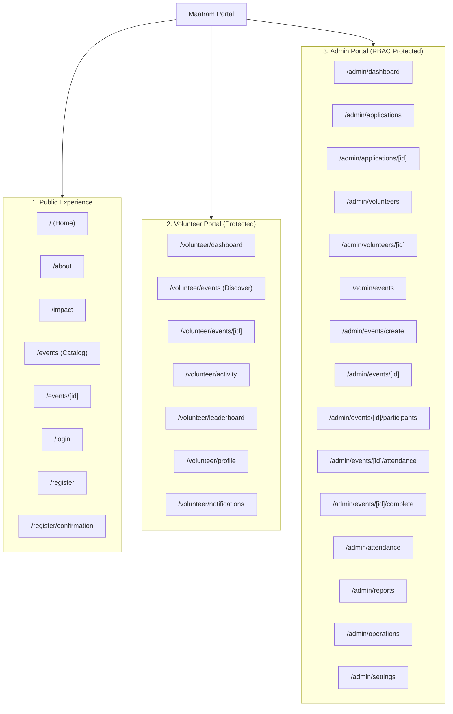
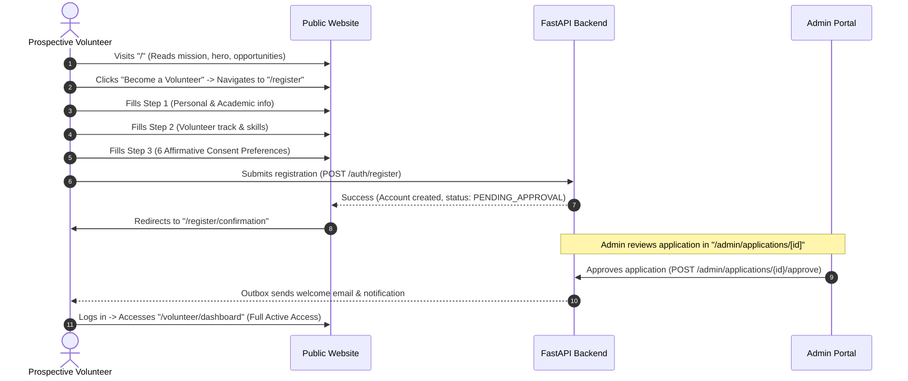
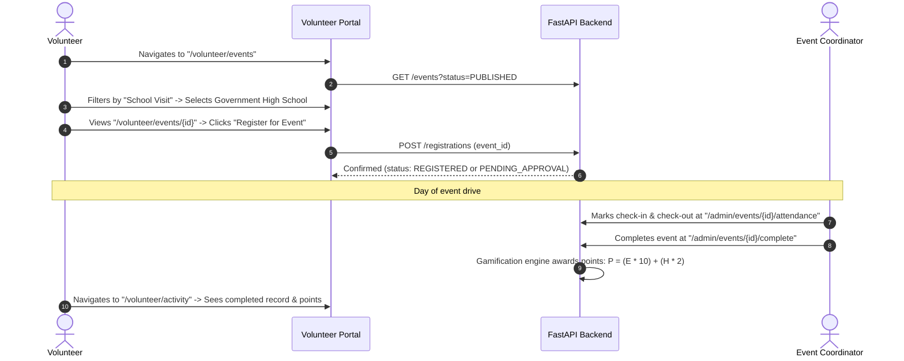

# M6_INFORMATION_ARCHITECTURE.md — Information Architecture & User Journey Specifications
**Maatram Volunteering & Gamification Portal**  
**Milestone 6.0: Information Architecture & Navigation Design**  
**Date:** November 2026 (Updated with Alignment Corrections)  
**Status:** **ALIGNED ARCHITECTURE SPECIFICATION**

---

## 1. Global Information Architecture Map

The Maatram portal is organized into three distinct operational domains, sharing a unified backend and design language:

---

## 2. Complete Route-to-Design Mapping

Every route in the Next.js application maps to a concrete visual shell, layout pattern, and authentication level:

| Route Path | Domain | Authentication Guard | Shell Component | Visual Template / Pattern |
| :--- | :--- | :--- | :--- | :--- |
| `/` | Public | None | `PublicHeader` + `PublicFooter` | Two-column editorial landing page with hero photography |
| `/about` | Public | None | `PublicHeader` + `PublicFooter` | Long-form editorial storytelling layout |
| `/impact` | Public | None | `PublicHeader` + `PublicFooter` | Metrics showcase + testimonial carousel layout |
| `/events` | Public | None | `PublicHeader` + `PublicFooter` | Public catalog with read-only cards |
| `/events/[id]` | Public | None | `PublicHeader` + `PublicFooter` | Detailed event page with login-to-apply callout |
| `/login` | Public | Redirect if Auth | `PublicHeader` + `PublicFooter` | Centered warm authentication card |
| `/register` | Public | Redirect if Auth | `PublicHeader` + `PublicFooter` | Multi-step progress card with affirmative consent toggles across all 6 dimensions |
| `/register/confirmation` | Public | None | `PublicHeader` + `PublicFooter` | Success illustration & review timeline card |
| `/volunteer/dashboard` | Volunteer | `VOLUNTEER` Role | `VolunteerShell` | Mentor Reference 2 (Hero, KPIs, Participation, Guide) |
| `/volunteer/events` | Volunteer | `VOLUNTEER` Role | `VolunteerShell` | Mentor Reference 3 (Search, Category Pills, Event Cards) |
| `/volunteer/events/[id]` | Volunteer | `VOLUNTEER` Role | `VolunteerShell` | Event detail layout with register/withdraw actions |
| `/volunteer/activity` | Volunteer | `VOLUNTEER` Role | `VolunteerShell` | Mentor Reference 4 (Tabs: Upcoming, Ongoing, Past, Ledger) |
| `/volunteer/leaderboard` | Volunteer | `VOLUNTEER` Role | `VolunteerShell` | Mentor Reference 5 (Category Tabs, Podium, Ranking Table) |
| `/volunteer/profile` | Volunteer | `VOLUNTEER` Role | `VolunteerShell` | Mentor Reference 6 (Identity Card, Tabs, All 6 Affirmative Consents) |
| `/volunteer/notifications`| Volunteer | `VOLUNTEER` Role | `VolunteerShell` | Notification list with filter tabs & action links |
| `/admin/dashboard` | Admin | `ADMIN` Role | `AdminShell` | KPI metrics, review queues, recent drives (Density Preserved) |
| `/admin/applications` | Admin | `ADMIN` Role | `AdminShell` | High-density data table with status filters and quick triage |
| `/admin/applications/[id]`| Admin | `ADMIN` Role | `AdminShell` | Detailed dossier, decision actions, mandatory reason audit |
| `/admin/volunteers` | Admin | `ADMIN` Role | `AdminShell` | Volunteer directory table, status badges, points |
| `/admin/volunteers/[id]` | Admin | `ADMIN` Role | `AdminShell` | Volunteer profile, participation history, point adjustment |
| `/admin/events` | Admin | `ADMIN` Role | `AdminShell` | Event list with lifecycle badges and create button |
| `/admin/events/create` | Admin | `ADMIN` Role | `AdminShell` | Structured form with date, venue, category, capacity |
| `/admin/events/[id]` | Admin | `ADMIN` Role | `AdminShell` | Event command center, roster overview, lifecycle tabs |
| `/admin/events/[id]/participants` | Admin | `ADMIN` Role | `AdminShell` | Participant management table, approve/reject registrations |
| `/admin/events/[id]/attendance` | Admin | `ADMIN` Role | `AdminShell` | Attendance verification table, QR check-in logs |
| `/admin/events/[id]/complete` | Admin | `ADMIN` Role | `AdminShell` | Event wrap-up checklist, point calculation preview |
| `/admin/attendance` | Admin | `ADMIN` Role | `AdminShell` | Master attendance ledger and manual adjustment modal |
| `/admin/reports` | Admin | `ADMIN` Role | `AdminShell` | Analytics charts, impact breakdowns, Excel export trigger |
| `/admin/operations` | Admin | `ADMIN` Role | `AdminShell` | Outbox health monitor, dead-letter jobs, retry actions |
| `/admin/settings` | Admin | `ADMIN` Role | `AdminShell` | Configuration parameters, email templates, audit log |

---

## 3. Core User Journeys

### 3.1 Journey 1: New Volunteer Onboarding & Privacy Preferences

### 3.2 Journey 2: Volunteer Event Discovery, Registration & Attendance

### 3.3 Journey 3: Gamification & Recognition Experience
- **Motivation Touchpoint**: Volunteer sees current rank (`#1`, `580 pts`) and progress donut (`62%`) on Dashboard.
- **Deeper Dive**: Clicks `"View Leaderboard ->"` to reach `/volunteer/leaderboard`.
- **Podium & Recognition**: Sees top-3 podium with gold, silver, and bronze pedestals and highlighted user rank row.
- **Privacy & Consent Protection**: Volunteer can independently toggle leaderboard visibility at `/volunteer/profile` (`leaderboard_visible` and `name_visible`), displaying as *Anonymous Volunteer* to peers while maintaining audit integrity for administrators.

---

## 4. Admin Portal Direction: Recommendation Under Review

The administrative interface requires a distinct balance:
- **Operational Data Density**: Must support rapid triage of high volumes of applications and volunteer records without unnecessary white space or decorative bloat.
- **Theme Treatment**: The proposed harmonization into a warm stone / dark charcoal palette (`#1C1D21` / `#FAF8F5`) is a **design recommendation under review**. Current baseline layout and functionality remain preserved until formal approval.
