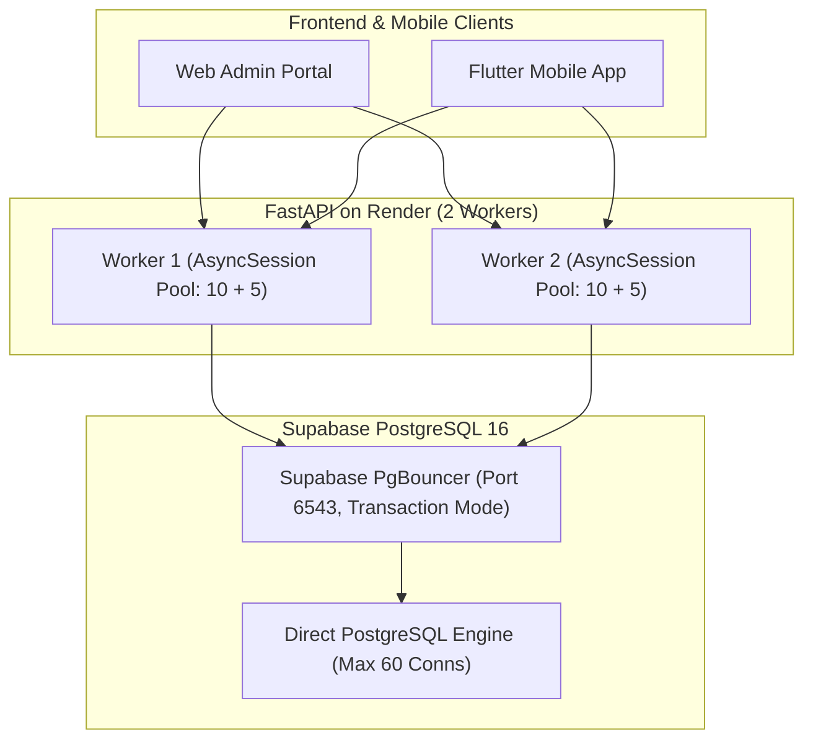

# Maatram Portal — Production Capacity & Sizing Recommendations

**Target Cloud Provider**: Render (FastAPI Web Service) + Supabase (PostgreSQL 16)  
**Document Version**: 1.0  
**Date**: 2026-11-15  
**Purpose**: Infrastructure sizing, connection pooling architecture, and capacity boundaries for production deployment.

---

## 1. Hosting Architecture & Sizing Specs

### 1.1 FastAPI Backend (Render Web Service)
| Component | Development / Staging | Production Recommended |
| :--- | :--- | :--- |
| **Instance Type** | Starter ($7/mo) | Standard ($25/mo) |
| **vCPU** | 0.5 vCPU | 1.0 - 2.0 vCPU |
| **RAM** | 512 MB | 1 GB - 2 GB |
| **Cold Starts** | Disallowed (Must run 24/7) | Disallowed (Always on) |
| **Uvicorn Workers** | 1 worker | 2 - 4 workers |
| **Process Model** | `uvicorn src.main:app` | `uvicorn src.main:app --workers 2` |

> [!IMPORTANT]
> The **Standard** tier is strongly recommended for production. Starter tier instances on Render are subject to CPU throttling during bursty operations (e.g. concurrent registration spikes or bulk attendance check-in drives), which can introduce latency spikes into Argon2id password verification.

### 1.2 Frontend Next.js Admin Portal (Vercel / Render Web Service)
* **Instance**: Node.js 20+ runtime, Static + SSR dynamic routes.
* **Timeout Configuration**: Aligned with `web/src/lib/api-client.ts` (`DEFAULT_TIMEOUT_MS = 30000`, `SLOW_CONNECTION_THRESHOLD_MS = 5000`).

---

## 2. Database Connection Pool Budgeting (FastAPI vs. Supabase)

A primary cause of production database outages is connection pool exhaustion under concurrent spikes. Below is the strict capacity budget aligning FastAPI's SQLAlchemy pool with Supabase limits.



### 2.1 Supabase Connection Boundaries
* **Direct Connection Limit (Port 5432)**: 60 connections max (Free/Starter plans).
* **Transaction Pooler (Port 6543, PgBouncer)**: Supports up to 200+ concurrent client connections multiplexed across 15-20 physical database backends.

### 2.2 SQLAlchemy Engine Settings
Located in `server/src/core/database.py`:
```python
engine = create_async_engine(
    settings.DATABASE_URL,
    pool_size=10,             # Steady-state connections per worker
    max_overflow=5,           # Burst headroom per worker
    pool_timeout=30.0,        # Max seconds to wait for a free connection
    pool_recycle=1800,        # Recycle idle connections every 30 minutes
    pool_pre_ping=True,       # Detect and discard severed connections before query
)
```

### 2.3 Math & Safety Verification
* With **2 Uvicorn workers**:
  $$\text{Max Peak Connections} = 2 \times (\text{pool\_size} + \text{max\_overflow}) = 2 \times (10 + 5) = 30\text{ connections}$$
* $30 \le 60$ (50% safety margin below Supabase direct connection limits).
* When routed via Supabase PgBouncer (port 6543), connection overhead is virtually eliminated.

---

## 3. In-Memory Cache Sizing & Memory Footprint

The lightweight `InMemoryTtlCache` (`server/src/core/cache.py`) maintains thread-safe cached responses for high-throughput public endpoints:
* **Event Discovery (`events:list:...`)**: 30-second TTL.
* **Global Leaderboards (`leaderboard:top:...`)**: 60-second TTL.

### Memory Overhead Analysis:
* Single JSON event list (50 events): $\approx 25\text{ KB}$
* Single JSON leaderboard payload (100 volunteers): $\approx 35\text{ KB}$
* Total memory footprint across all active cache entries: **$< 5\text{ MB}$**
* Impact on 1 GB Render instance: **$< 0.5\%$ of available RAM**.
* **Safety**: Because invalidation is driven by event mutations and point awards (`invalidate_prefix`), the cache never serves stale data after an administrator or volunteer performs an update.

---

## 4. Health Check & Readiness Probing Strategy

To ensure zero-downtime rolling deploys on Render:
1. **Liveness Probe (`GET /api/v1/health/live`)**:
   - Pure application heartbeat.
   - Response time: $< 2$ ms.
   - If unresponsive, Render orchestrator restarts the container.
2. **Readiness Probe (`GET /api/v1/health/ready`)**:
   - Verifies database connectivity with `SELECT 1`.
   - Timeout configured to `DB_READINESS_TIMEOUT_SECONDS = 5.0` (configurable via environment).
   - Prevents traffic routing to unready or migrating instances without triggering premature container kills.

---

## 5. Scaling Thresholds & Decision Matrix

| Condition | Observed Metric | Action |
| :--- | :--- | :--- |
| **Normal Operation** | CPU $< 50\%$, RAM $< 60\%$, p95 $< 150$ ms | Maintain 1 instance (Standard, 2 workers) |
| **High Traffic Spike** | CPU $> 75\%$ sustained, p95 $> 300$ ms | Scale to 2 instances horizontally on Render |
| **Multi-Node Deployment** | Multiple backend containers active | Replace `InMemoryTtlCache` with hosted Redis cluster |
| **Database Saturation** | Supabase CPU $> 80\%$ or conns $> 50$ | Enforce PgBouncer transaction pooling port 6543 |

