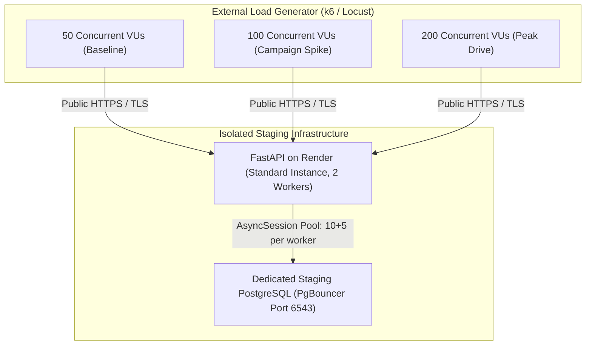

# Maatram Portal — Staging Load Testing Specification & Execution Plan

**Document Version**: 1.0  
**Target Environment**: Isolated Staging (Render Web Service + Dedicated Staging PostgreSQL)  
**Tools**: k6 / Locust  
**Target Concurrency Profiles**: 50, 100, and 200 Concurrent Users  
**Safety Mandate**: **Never execute against the shared Supabase development database.**

---

## 1. Staging Isolation Architecture & Test Data



### 1.1 Test Isolation Rules
1. **Isolated Database**: The test must point strictly to `https://staging-api.maatram.org` backed by a dedicated staging database (`maatram_staging`), never the shared development database.
2. **Synthetic Seed Data**: Pre-seed the staging database with:
   - 250 verified synthetic volunteer accounts (`loadtest_vol_001@maatram-test.org` to `loadtest_vol_250@maatram-test.org`).
   - 5 administrator accounts (`loadtest_admin_01@maatram-test.org` to `05`).
   - 20 published events with various capacity sizes (10 to 100 capacity).
   - 50 pending volunteer applications for admin queue load.

---

## 2. Workload Scenarios & Traffic Distribution

The test represents a peak volunteer admissions drive:

| Scenario | Weight | Critical Flows Covered | Target Endpoints |
| :--- | :--- | :--- | :--- |
| **A. Read-Heavy Catalog** | **70%** | Event Discovery, Leaderboard, Profile, Notifications | `GET /api/v1/events?status=PUBLISHED`<br>`GET /api/v1/gamification/leaderboard`<br>`GET /api/v1/volunteers/me`<br>`GET /api/v1/notifications` |
| **B. Mutating Operations** | **15%** | Event Registration, Attendance QR Check-in | `POST /api/v1/events/{id}/registrations`<br>`POST /api/v1/events/{id}/attendance/check-in` |
| **C. Admin Portal Ops** | **15%** | Executive Dashboard, Pending Volunteer Review | `GET /api/v1/admin/dashboard/metrics`<br>`GET /api/v1/applications?status=PENDING` |

---

## 3. Stepped Concurrency Ramp Profiles

```
Concurrent VUs
  200 |                   /-------------\
      |                  /               \
  100 |          /------/                 \------\
      |         /                                 \
   50 |  /-----/                                   \-----\
      | /                                                 \
    0 +----------------------------------------------------> Time (minutes)
         0   2   7   9   14  16          21  23    28  30
```

1. **Ramp 1 (Baseline — 50 VUs)**:
   - Ramp-up: 0 to 50 VUs over 2 minutes.
   - Steady-state: 50 VUs for 5 minutes.
   - Purpose: Establish baseline steady-state latency and connection pool stability.
2. **Ramp 2 (Campaign Spike — 100 VUs)**:
   - Ramp-up: 50 to 100 VUs over 2 minutes.
   - Steady-state: 100 VUs for 5 minutes.
   - Purpose: Simulate a statewide volunteer newsletter dispatch or social announcement.
3. **Ramp 3 (Peak Admissions Drive — 200 VUs)**:
   - Ramp-up: 100 to 200 VUs over 2 minutes.
   - Steady-state: 200 VUs for 5 minutes.
   - Cooldown: 200 to 0 VUs over 2 minutes.
   - Purpose: Stress-test maximum connection concurrency, lock contention, and p99 latency.

---

## 4. Executable k6 Load Test Script (`staging_load_test.js`)

Save the following script to `tests/load/staging_load_test.js`:

```javascript
import http from 'k6/http';
import { check, group, sleep } from 'k6';
import { Counter, Rate, Trend } from 'k6/metrics';

// Custom Metrics
const errorRate = new Rate('custom_error_rate');
const eventLatency = new Trend('event_discovery_duration');
const leaderboardLatency = new Trend('leaderboard_duration');
const checkinLatency = new Trend('checkin_duration');

export const options = {
  stages: [
    { duration: '2m', target: 50 },   // Ramp up to 50 VUs
    { duration: '5m', target: 50 },   // Hold 50 VUs
    { duration: '2m', target: 100 },  // Ramp up to 100 VUs
    { duration: '5m', target: 100 },  // Hold 100 VUs
    { duration: '2m', target: 200 },  // Ramp up to 200 VUs
    { duration: '5m', target: 200 },  // Hold 200 VUs (Peak)
    { duration: '2m', target: 0 },    // Ramp down to 0
  ],
  thresholds: {
    'http_req_duration': ['p(95)<350', 'p(99)<750'], // 95% of requests under 350ms
    'custom_error_rate': ['rate<0.005'],              // Error rate under 0.5%
    'event_discovery_duration': ['p(95)<200'],        // Fast event listing
    'leaderboard_duration': ['p(95)<250'],            // Fast leaderboard queries
  },
};

const BASE_URL = __ENV.TARGET_URL || 'https://staging-api.maatram.org/api/v1';

export function setup() {
  // Pre-test authentication: Obtain tokens for synthetic test users
  const loginRes = http.post(`${BASE_URL}/auth/login`, JSON.stringify({
    username: 'loadtest_vol_001@maatram-test.org',
    password: 'StagingPassword123!',
  }), { headers: { 'Content-Type': 'application/json' } });

  check(loginRes, { 'setup login successful': (r) => r.status === 200 });
  const token = loginRes.json('access_token');
  return { token };
}

export default function (data) {
  const headers = {
    'Authorization': `Bearer ${data.token}`,
    'Content-Type': 'application/json',
  };

  const rand = Math.random();

  if (rand < 0.70) {
    // 70% Read-heavy Scenario: Event Discovery & Leaderboard
    group('Event Discovery & Leaderboard', function () {
      const resEvents = http.get(`${BASE_URL}/events?status=PUBLISHED`, { headers });
      eventLatency.add(resEvents.timings.duration);
      const okEvents = check(resEvents, { 'events 200 OK': (r) => r.status === 200 });
      errorRate.add(!okEvents);

      const resLeaderboard = http.get(`${BASE_URL}/gamification/leaderboard`, { headers });
      leaderboardLatency.add(resLeaderboard.timings.duration);
      const okLb = check(resLeaderboard, { 'leaderboard 200 OK': (r) => r.status === 200 });
      errorRate.add(!okLb);

      const resProfile = http.get(`${BASE_URL}/volunteers/me`, { headers });
      const okProf = check(resProfile, { 'profile 200 OK': (r) => r.status === 200 });
      errorRate.add(!okProf);
    });
  } else if (rand < 0.85) {
    // 15% Mutating Scenario: Attendance Check-in simulation
    group('Attendance & Registration', function () {
      // Check-in on demo event
      const checkinPayload = JSON.stringify({
        notes: 'Staging k6 automated verification',
      });
      const resCheckin = http.post(
        `${BASE_URL}/events/00000000-0000-0000-0000-000000000001/attendance/check-in`,
        checkinPayload,
        { headers }
      );
      checkinLatency.add(resCheckin.timings.duration);
      // Valid check-in returns 200; duplicate check-in returns 409 (both acceptable for load)
      const okCheckin = check(resCheckin, {
        'checkin handled': (r) => r.status === 200 || r.status === 409 || r.status === 400,
      });
      errorRate.add(!okCheckin);
    });
  } else {
    // 15% Admin Dashboard Analytics
    group('Admin Analytics', function () {
      const resDash = http.get(`${BASE_URL}/admin/dashboard/metrics`, { headers });
      const okDash = check(resDash, { 'admin dashboard 200 OK': (r) => r.status === 200 });
      errorRate.add(!okDash);
    });
  }

  // Realistic user think time between actions: 1 to 3 seconds
  sleep(Math.random() * 2 + 1);
}
```

---

## 5. Execution Command & Key Performance Indicators (KPIs)

### 5.1 Run Command
```bash
# Execute from an independent staging machine or GitHub Actions runner
k6 run --env TARGET_URL="https://staging-api.maatram.org/api/v1" tests/load/staging_load_test.js
```

### 5.2 Pass/Fail Acceptance Criteria

| Concurrency Level | Target Throughput | p50 Latency | p95 Latency | Error Rate | Pool Timeouts |
| :--- | :--- | :--- | :--- | :--- | :--- |
| **50 Concurrent VUs** | $> 40$ req/sec | $< 50$ ms | $< 150$ ms | $0.0\%$ | 0 |
| **100 Concurrent VUs** | $> 80$ req/sec | $< 80$ ms | $< 250$ ms | $< 0.1\%$ | 0 |
| **200 Concurrent VUs** | $> 150$ req/sec | $< 120$ ms | $< 400$ ms | $< 0.5\%$ | 0 |

If `custom_error_rate` exceeds $0.5\%$ or database pool timeouts occur (`QueuePool limit of size 10 overflow 5 reached`), the test is flagged as **BLOCKED** and requires adjusting the Uvicorn worker count or scaling PgBouncer transaction limits.

